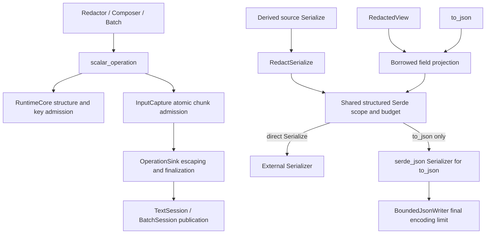

# qubit-redact Design

[中文设计文档](design.zh_CN.md) · [User Guide](user_guide.md) · [README](../README.md)

Current runtime: qubit-redact 0.10.0; workspace derive: qubit-redact-derive 0.9.0. The runtime requires derive 0.9 or newer within that minor line; the package version numbers are independent. Rust 1.94, empty default features.

## 1. Goals and boundaries

`qubit-redact` provides policy-driven, resource-bounded redaction for logs,
errors, and support diagnostics. It handles fields, domain objects, JSON, URI,
HTTP, environment variables, argv, and process descriptions. With redaction
enabled, every published `Complete`, `Truncated`, or `Exhausted` result must
exclude source values that were not approved for publication.

The crate does not erase memory, mutate source objects, or protect output that
bypasses its runtime. Field sensitivity is downstream domain knowledge: domain
models must identify sensitive fields explicitly instead of relying on guesses
from Rust types or current values.

## 2. Core invariants

1. `Redactor` owns an immutable `Arc<RedactionPolicy>` snapshot. Existing
   objects do not observe later application-default replacements.
2. Every composer, batch, or inspection owns an independent transaction and
   budget ledger.
3. Parser errors, input truncation, and budget exhaustion fail closed while
   redaction is enabled.
4. Scalar keys pass structural-length and input-byte admission before classification;
   classification precedes lazy value access or formatting.
5. Depth, nodes, collection items, input bytes, JSON values, and output bytes
   are charged to the same transaction.
6. Only a completed transaction constructs public summaries. Parsers and
   format executors never publish a second result model.
7. `RedactionPolicy::disabled()` is an explicit debugging escape hatch that
   restores source values; downstream code owns authorization and timing.
8. Hidden structured-Serde adapters establish a root admission scope when
   invoked directly and reuse an existing scope when nested. Calling a hidden
   capability without a scope must fail closed rather than bypass limits.

## 3. Architecture

```text
caller
  │
  ▼
Redactor + immutable RedactionPolicy snapshot
  ├── RedactedTextComposer ── TextSession ──► RedactionTextOutput
  ├── redact_* ────────────── TextSession ──► RedactionTextOutput
  ├── DiagnosticRedactionBatch ──────── BatchSession ─► diagnostics + handles
  └── inspect_* ───────────── InspectionSession ─► Result<RedactionInspection, Error>
                                  │
                                  ▼
                    RuntimeCore: budget, summary, phase
                                  │
                 ┌────────────────┼────────────────┐
                 ▼                ▼                ▼
              domain           formats          output
       RedactionWriter       JSON/HTTP/...   escaping and markers
```

Source responsibilities are:

- `facade`: public entry points, composer, batch, output, and summaries;
- `policy`: field and context rules, masks, and resource limits;
- `runtime`: shared transaction state, budgets, structural admission, sinks,
  and publication;
- `domain`: `Redact`, `RedactionWriter`, container adapters, and optional Serde
  bridges;
- `formats`: argv, env, process, JSON, URI, and HTTP parsing and rendering;
- `output`: log escaping, masked text, and completion states.

The façade, domain, and format layers depend on runtime and policy. Runtime is
independent of the public façade operation model. Formats return internal
`RenderedOperation` values, and the parent transaction is the only publisher.

### 3.1 Consumer views and two execution ledgers



A view borrows its source and owns an immutable policy snapshot. Creation does not access
the source; each formatting or serialization executes afresh. Text uses `Redact`, while
structured view Serde uses the hidden `RedactSerializeSource` projection capability. It borrows field data for the local serialization call. Only `#[redact(serde)]` additionally replaces ordinary source
serialization through the legacy `RedactSerialize` bridge. Explicit derive levels belong to the domain type and remain final under strict
policy. A hand-written `sensitive_at_least` is a minimum and combines with runtime classification
by taking the stronger level, so strict can raise it. Unannotated fields generally retain ordinary
representations. During derive normalization, a field with no redaction attribute or custom Serde
serializer is automatically marked `nested` when its syntax matches a supported self-recursive shape.
Explicit `unmarked` opts out. This is syntax normalization, not runtime sensitivity inference; arbitrary
aliases and cross-type recursion graphs are not resolved. Text recognition covers direct recursion and
supported wrappers including `Option`, `Box`, `Vec`, tuples, arrays, and parentheses, while Serde projection
is limited to direct recursion, `Option<Box<Self>>`, and `Vec<Box<Self>>`.

Nested view projections use `RedactSerializeSource`, whose generic associated view
allows Option, Vec, and other supported containers to borrow data for the current
call. The source type does not need ordinary `Serialize` unless a field’s pass-through
mode requires it. For `serialize_with` adapters, generated field carriers retain only
generics referenced by the field type or adapter path, plus transitively required
predicates; unrelated source parameters are not copied. Separately, `#[redact(serde)]` preserves the source type’s existing
ordinary-serialization bridge through `RedactSerialize`; this legacy path has its own
capability bounds and is not equivalent to the view projection. Unsupported view
capabilities fail when serialization is requested, while text-only derives remain valid.
Self-recursive `nested` edges through supported containers (for example,
`Option<Box<Node>>` or `Vec<Box<Node>>`) use lazy child projection factories to avoid
recursive associated-type obligations. `redact_view()` and `to_json()` retain the same
field capability requirements as other projections; this does not add ordinary source
`Serialize` as a blanket requirement.
Projection helper declarations preserve source generic constraints against the original source type.
Recursive `Vec` projections admit their container node and cumulative item count before creating or
traversing the sequence; node rejection uses the safe replacement, while item rejection returns a
serializer error before element callbacks begin.
Each projected Option layer also admits its own node and depth before emitting `serialize_some` or
`serialize_none`; it does not add a collection item. Explicit Display scalar adapters admit their
structure before invoking the source formatter. Rejection uses the existing safe structural
replacement, while disabled policy continues to enforce structural budgets. Recursive
`skip_serializing_if` predicates resolve `Self` against the original source type, preserving the
same path semantics in lazy recursive projections.

Text RuntimeCore and synchronous Serde scopes have different lifetimes and own separate
ledgers. Serde scopes use PolicyFrame Arc snapshots and thread-local guards; nested and
ordinary serializers share the active budget, and errors or panic unwinding release the scope.
An original policy address is only a snapshot-reuse hint: its contents must still equal
the owned snapshot. This prevents a forgotten guard from applying an obsolete policy
after the caller replaces a policy at the same address.
Pre-serialization for measurement followed by a second execution is forbidden.

## 4. Policy model

`RedactionPolicy` combines field rules, masks, format policy, and
`RedactionLimits`. `standard()` is deterministic, `strict()` treats unknown
fields as `Secret`, and `disabled()` explicitly disables confidentiality
redaction.

Field resolution applies base rules before HTTP header/query/body context
rules. Context may strengthen sensitivity but cannot weaken an already stronger
base decision. The shared `ResolvedField::stronger` implementation owns this
security rule so formats do not duplicate it.

`RedactionFloor` composition retains independent rule layers and resolves
matching protections by maximum sensitivity. Editing a composed floor through
its builder changes the editable layer while retaining the other layers and
their matching and fallback behavior; rebuilding therefore preserves the
composed floor semantics.

`Redactor::application_default()` reads a snapshot from the process-wide slot.
`replace_application_default()` replaces that slot linearly and returns the
previous value. Existing redactors, composers, and batches retain their prior
snapshot.

## 5. Transaction and publication models

### 5.1 Composer

`RedactedTextComposer` appends literals and redacted operations in order.
`literal` accepts only `&'static str`; dynamic data must use a redaction
operation. Consuming `finish(self)` publishes one `RedactionTextOutput`.

### 5.2 Batch

`DiagnosticRedactionBatch` creates independently resolvable items under one shared
budget. Each operation returns a handle valid only for that batch.
`finish_with_marker(self, marker)` publishes a diagnostics view: complete
items retain their safe text, while incomplete, missing, and cross-batch
handles resolve to the escaped marker. The view also retains the aggregate
summary.

### 5.3 Inspection

Inspection reuses policy and structural budgets and returns whether policy
evaluation was disabled, the strongest sensitivity found by the complete
traversal, and resource usage without publishing raw values. It does not expose
per-field rule-match traces. `RedactionPolicy::classify_field` explains the first
matching application rule; `RedactionPolicy::sensitivity_for` resolves the final
level from application rules and matching floors. An inspection error means the
conclusion is incomplete and must be treated as sensitive when inspection
controls a security decision.

### 5.4 RuntimeCore

`RuntimeCore` stores the policy snapshot, `RedactionBudget`, aggregate
`SummaryBuilder`, transaction phase, and optional item summary. `TextSession`,
`BatchSession`, and `InspectionSession` provide different publication models on
top. Operation sinks commit format results to the parent transaction instead of
creating child budgets or summaries.

## 6. Admission, budgeting, rendering, and publication

Structured operations use one pipeline:

```text
validate metadata
  → budget preflight
  → shared structural preflight
  → strict JSON decode and tree materialization
  → formal shared and JSON-specific admission
  → policy resolution
  → bounded rendering and log escaping
  → record usage/reason/completion
  → publish through the parent transaction
```

Preflight happens before advancing untrusted iterators. For JSON text, a
read-only shared structural preflight checks syntax and shared depth/node/item
ceilings before tree materialization. It does not charge the real ledger. On
success, the unique decoder performs its own lexical validation and strict tree
construction, then the seed formally charges shared structure once. Thus one
materialization does not imply one scan; the parser-entry test counter does not
measure lexical scans internal to the decoder. Input bytes are charged when
admitted before structural preflight, while a rejected tree adds no shared
visited-node or collection-item usage. Node/item rejection closes transaction
traversal; shared depth rejection does not. Failure precedence is
output/input admission, shared structural preflight, then JSON-specific
admission/materialization.
The shared `max_key_bytes` ceiling applies to domain fields and supported
non-JSON format classification keys; decoded JSON object keys use the
independent `max_json_key_bytes` ceiling. Callers that need bounds for both
scopes configure both limits. JSON text, borrowed `Value`, and HTTP JSON use
the JSON ceiling, while URI and form keys use the shared format-key ceiling.

HTTP JSON, NDJSON, and multipart rendering borrow the admitted structures
within the operation, without rebuilding a masked `Value` tree or mutating
source values. The bounded writer serializes directly from the borrowed nodes.

The JSON visitor preserves the first structural rejection cause. Shared structural
depth rejection becomes `DepthLimitReached`; shared node or collection rejection and
JSON-specific budget or transaction-commit rejection remain
`TraversalLimitReached`. The `Value` entry points therefore retain the same shared-depth
reason as inspection and rendering of JSON text instead of collapsing every failure to
a boolean traversal reason. JSON text and `Value` writer admission failures retain
their recorded reason rather than adding a second traversal reason; a replacement that
cannot fit may additionally record actual `OutputLimitReached`.

At a domain-to-JSON boundary, the JSON root starts at the current domain depth plus
one. Borrowed-value admission adds each JSON-relative depth to that base for both
admission and usage; text preflight and its decoder seed share the same absolute root.
Standalone JSON starts at depth one, and `max_json_depth` remains relative to its
JSON root. Thus domain depth 2 containing JSON depth 2 uses shared depth 4 and
requires `max_depth` to allow that combined depth.

The strict text contract rejects duplicate object keys after decoding their
strings, requires negative integers to fit `i64`, non-negative integers to fit
`u64`, and fractional/exponent numbers to be finite `f64`. The decoder applies
configured shared and JSON-specific depth budgets and has no additional fixed
127-container cap. A borrowed `Value` skips raw-text validation, so it cannot
recover the original input bytes or detect duplicate source keys. Test-time
`serde_json/arbitrary_precision` feature merging protects the number contract;
it does not make arbitrary-precision inputs supported.

For each derived `#[redact(json)]` field backed by `serde_json::Value`, JSON-specific
limits are checked against that field's complete tree and are not accumulated across
fields. General Serde structure and payload limits continue to accumulate in the active
Serde scope. Disabled policy skips this added JSON-specific check; existing Serde scope
accounting and final output limits still apply. The `String` and `Value` forms retain distinct
wire types: the former serializes as a string, while the latter serializes as JSON structure.
`to_json` applies its final encoded-byte limit; direct view/source serialization leaves
final encoding size to the caller's serializer and writer.

Flat structured formats such as argv and environment lists use one runtime
admission helper for root nodes, collection entries, child nodes, and source
bytes. Composer and batch retain different publication models, but cannot
silently drift in how they advance or charge the same source iterator.

When output space is insufficient, the runtime retains only complete UTF-8
prefixes and safe markers. `Truncated` means a safe but incomplete
representation remains; `Exhausted` means the budget could not retain a full
replacement. Callers read `RedactionSummary` and must not infer reasons by
parsing marker text.

`Complete` describes output completeness, not source validity or the absence
of reasons: a complete safe parse-error replacement can carry `InvalidUri`.
`complete_text` and marker helpers select by completion state; callers that
require valid input use format inspection or check the relevant parsing
reason.

### 6.1 Scalar admission, failure facts, and output closure

One-shot, composer, and batch share `runtime/scalar_operation.rs`: output preflight,
root-node admission, key-length check, key input-byte admission, classification, then formatting
only if needed. Rejected keys increase presented but not inspected bytes, without normalization
or value access. With redaction enabled, High/Secret writes a fixed mask after key admission.
Scalar inspection admits its root node and raw UTF-8 key bytes before charging the presented
field and value bytes; classification runs only after all admissions succeed. Rejection returns
an inconclusive inspection and prevents classification, including when the policy is disabled.
`InputCapture` admits complete UTF-8 chunks and latches its first rejection. Accepted prefixes
remain charged but all raw text is discarded on failure. `ScalarFailure` distinguishes
InputLimit from FormatterFailure without carrying a public completion state.

OperationSink owns safe replacement and final state. If `<truncated>` fits after input or
formatter failure, completion is Truncated with only its real cause. If it cannot fit,
completion is Exhausted with actual OutputLimitReached. Actual output truncation with a fitting
marker is Truncated + OutputLimitReached. Ordinary masks are Complete. `RenderedOperation`
carries an independent output_closed fact; merge combines that fact, reasons, and completion.
Publication neither infers output exhaustion from generic failure nor discards earlier safe text.
Exhausted always has an output reason at its construction boundary.

An input-failing item allows later admitted work within the remaining budget; the aggregate
summary stays incomplete. Empty failed batch items use a shared rejected handle without allocating
a result slot; the batch summary still accumulates each rejection reason and usage. Actual output rejection or exact capacity closes subsequent input
access. Caller-supplied post-publication markers are escaped but outside transaction output limits.

### 6.2 Serde payload and final encoding

`max_input_bytes` defaults to 64 KiB. `max_serde_payload_bytes` (serde feature) and
`max_output_bytes` independently default to 16 KiB. All allow zero; the latter two must fit isize::MAX.
Payload follows Serde events: UTF-8 strings/chars, byte slices, numeric/bool scalar representations,
zero for none/unit, dynamic map keys, and scalar unit-variant names. Static field names,
punctuation, escaping, and framing are excluded. Each logical scalar payload is
charged once, including when a nested redacted value forwards it through another
budget adapter. Input and structural admission remain in force.
For `collect_str`, formatting failure still charges the accepted input prefix; payload is charged
only for scalar text forwarded to the downstream serializer.
Each projected `Option` layer, whether `Some` or `None`, consumes one shared
structural node and one depth level. Disabled policy continues to enforce
shared structure and depth; JSON text string leaf nodes still consume one node
and their depth even though JSON-specific limits are skipped.

Direct Serialize(view/source) uses structure, input, and logical payload limits; the caller's
serializer/writer controls final encoding. `to_json` uses the same projection plus an independent
BoundedJsonWriter for all final bytes, including labels, escapes, quotes, punctuation, and masks.
It traverses once and returns a String only after complete encoding, keeping
Result<String, serde_json::Error>. Structural degradation may produce valid safe replacements,
so success does not imply completeness. Identical source state yields matching output when
both operations succeed; their success conditions are not equivalent.

Scalar text fields, handwritten domain nodes, and Serde events have distinct input admission
units; usage is not source-object memory size. Budgets cannot preempt arbitrary computation
inside user Display/Serialize or bound allocations performed before the library call.
Explicit Low/Medium domain text captures the source formatter once under the shared input-byte
allowance and charges accepted UTF-8 bytes even when formatting fails. High/Secret and inspection
avoid source formatting; disabled explicit text remains input-bounded.

## 7. Domain objects and Serde

`Redact::write_redacted` writes only through the active `RedactionWriter`.
The writer supports records, sequences, maps, nested values, explicit
sensitivity, runtime-key classification, JSON values, and explicit skips. Every
scope shares the parent budget; depth or collection rejection closes that scope
without opening another output path.

The `derive` feature exports `#[derive(Redact)]` and `#[derive(RedactScalar)]`; generated serialization
adapters additionally require `serde`. Hidden support traits and borrowed
adapters cover scalars, options, references, common containers, tuples, maps,
and JSON ownership forms. They are public only because generated code expands
in downstream crates; they are not an alternative user-facing serialization
API. Root adapters establish or reuse the thread-local structural budget. Borrowed
field projections use `RedactSerializeSource` for supported containers such as Option, Vec,
fixed arrays, and tuples; slices are not supported for nested projections. Slice support belongs to
explicit level redaction, where slices serialize as sequences, while admitted fixed arrays serialize as tuples. These projections require
an existing scope, and return a value-free serializer error when it is absent, even for empty containers. Direct
construction therefore cannot skip collection, depth, node, or input admission.
The internally tagged serializer accepts only map and struct shapes that
preserve the intended structure; unsupported Serde shapes return explicit
errors.

Redacted serialization preserves the source Serde event shape: `Option::Some`
uses `serialize_some`, level slices serialize as sequences, fixed arrays serialize as tuples, and wrappers forward the
destination serializer's human-readable preference. JSON output retains its
existing shape while non-JSON serializers receive the intended option, tuple,
and representation events.
Derived transparent, adjacent-tagged, and untagged representations also use
Serde's effective events and names. Transparent projections ignore
`skip_serializing_if`, matching native Serde field forwarding; redaction-specific
`skip` behavior remains separate. Variant-level redact attributes are rejected
because derive redaction is defined on containers and fields. Adjacent tags retain the enum name, variant
index, and serialized variant name. The corrected `Some` and fixed-array Tuple
events apply to direct source serialization enabled by `#[redact(serde)]` and
borrowed views. These corrections preserve JSON shape but change event streams
observed by non-JSON serializers; persisted data written with earlier events may
require its prior decoder or an explicit format version. Migration should read
old data with the old implementation and re-encode it with the corrected one;
the new event layout does not automatically decode the old layout. In particular,
`Option<Map>::Some` emits a `Some` event containing the map. Applications should
read persisted data with the old decoder and re-encode it, or define an
application-level format version; the library does not auto-detect or decode the
earlier layout.

## 8. Format layer

- argv: with redaction enabled, heuristic mode treats unclassified non-Unicode
  arguments as Secret. Explicit mode preserves `ArgvItem::plain` values using
  lossy Unicode conversion; callers must classify sensitive values explicitly
  or select heuristic mode. Non-Unicode OS arguments include invalid UTF-8 on
  Unix and unpaired UTF-16 surrogates on Windows. Non-UTF-8 environment names are conservatively
  classified as Secret independently of this argv rule; disabled inspection
  bypasses environment-name classification. A disabled policy restores values
  under its existing contract. Process redaction applies heuristic argv rules
  to its arguments, not explicit `redact_argv` behavior;
- JSON: strict tree construction, recursive field classification, explicit number ranges, and
  shared structural limits;
- URI: `fluent-uri` parsing with separate identity, path, query, and fragment
  handling;
- HTTP: URL, headers, and bodies, always returning to the parent transaction.
  URL query parameters use query rules; form fields in
  `application/x-www-form-urlencoded` bodies use body rules.

`UriRedactionBoundary` derives an effective URI policy from the application
snapshot: it enables confidentiality, adds the standard URI floor, and uses
standard masks while retaining application limits and path/fragment
configuration. The standard field floor does not force every path or fragment
to be hidden. Admission decisions use inspection and reject sensitive or
inconclusive results; complete redacted text is not a URI syntax certificate.

HTTP body implementation is split by responsibility:

- `src/formats/http/internal/http_policy_executor/body.rs`: admission dispatch and final publication;
- `json_body.rs`: JSON and NDJSON;
- `form_body.rs`: `application/x-www-form-urlencoded`;
- `multipart_body.rs`: multipart parts, nested content types, and file data;
- `text_body.rs`: text, binary, and unsupported fallbacks;
- `url.rs`: URL, nested URL, and query processing;
- `headers.rs`: header rendering;
- `diagnostics.rs`: bounded diagnostic text and completion.

Native `HeaderValue` and text Content-Type inspection atomically admit the captured body and metadata bytes before decoding or inspecting metadata. A rejected input records its admission reason without reporting `InvalidContentType`; an admitted but invalid native header is charged before that reason is recorded.

Body admission parses top-level Content-Type metadata once and retains its typed classification for rendering. Successful multipart admission also retains the validated boundary and form-data requirement beside its admitted parts. The renderer reuses this metadata; a separate inspection operation performs its own classification. Header-parameter scanning uses a borrowed segment cursor, validates every value, and decodes only values requested by the caller while preserving case-insensitive duplicate detection.

HTTP URL inspection and rendering share one path-redaction predicate. It treats a non-empty opaque path as redactable, preserves a hierarchical root path, and does not classify an empty opaque path as sensitive by itself.

These modules share a private `HttpPolicyExecutor`. It borrows the parent
session policy, owns no session, and produces no public HTTP result. Invalid
content types, missing multipart boundaries, invalid JSON/NDJSON, and truncated
input use safe markers with structured reasons.

Nested multipart JSON/NDJSON parsing failures retain `InvalidJson`, while
resource admission failures retain their limit reason. Nested URL rendering
accumulates `InvalidUri` and `DepthLimitReached` reasons from child operations
into the parent result.
Multipart framing is validated in a complete pass through a borrowed segment
cursor before the segments are consumed. Auxiliary segment state does not scale
with the raw segment count; admitted slots grow only for admitted parts. Top-level
form fields use depth 2, while form fields inside multipart parts use depth 3 in
both inspection and rendering. Admitted JSON and NDJSON values are retained
and reused during rendering. Form inspection and rendering share the same raw-segment admission,
so an exhausted segment allowance takes precedence over syntax classification and accepted segments
are charged once in either path. NDJSON admission stores nonblank values with source-line indices
and counts blank lines separately, keeping auxiliary storage constant for blank
runs. Rendering restores line breaks through the bounded output writer, including
for multipart NDJSON.
Opaque non-text multipart parts do not require UTF-8 decoding; sensitive non-UTF-8 parts use the
opaque mask for their effective sensitivity.

### 8.4 URL parsing benchmark decision

The URL benchmark constructs inputs outside the timed loop and measures one-shot and single-item
batch calls separately. It uses Criterion with 30 samples, a 1-second warm-up, and a 2-second
measurement window per case on Linux x86_64 with Rust/Cargo 1.94.0. The command for each round was
`cargo bench --bench http_uri_bench --features http,uri -- --save-baseline rr04-before-N --sample-size 30 --warm-up-time 1 --measurement-time 2`.
Each cell below is the mean point estimate and 95% confidence interval in microseconds for rounds 1/2/3.

| Workload | One-shot rounds 1 / 2 / 3 | Single-item batch rounds 1 / 2 / 3 |
| --- | --- | --- |
| Short URL | 28.92 [23.37, 34.82] / 43.63 [31.46, 57.88] / 39.09 [31.75, 47.10] | 26.75 [22.86, 31.06] / 29.85 [23.45, 36.37] / 53.58 [42.27, 65.48] |
| 128-item query | 484.35 [374.84, 623.90] / 1040.61 [926.06, 1169.31] / 3605.74 [2812.33, 4453.14] | 1803.58 [1648.05, 1957.43] / 701.74 [535.35, 885.03] / 2967.35 [1593.08, 4852.11] |
| Three-level nested URL | 104.33 [88.78, 120.71] / 75.57 [58.85, 93.35] / 208.09 [165.37, 254.83] | 142.44 [115.09, 172.99] / 89.06 [63.23, 126.42] / 170.58 [123.05, 223.77] |

The run-to-run spread is larger than the proposed 5% improvement threshold, and the intervals do not
support a stable before estimate. No candidate root-URL reuse was measured or retained; RR-04 closes
as a completed investigation with no production optimization. The benchmark remains for a future
controlled comparison.

`BodyCapture` alone owns source-truncation metadata. The parent runtime rejects
an HTTP body atomically when its captured bytes exceed the remaining input
allowance; renderers therefore do not model a second partial-input state. Content-Type bytes share
that atomic admission in both native and text inspection paths.

### 8.5 RRD-02 controlled measurements

One controlled run used Rust/Cargo 1.94.0 on x86_64 Linux. Allocation counts came from the public HTTP body APIs in the test profile (`opt-level=0`, `debug=0`); input, policy, and native `HeaderValue` construction were outside each counter window. Values below are alloc/realloc calls and cumulative requested bytes, not peak memory:

| Workload and entry point | Before | After |
| --- | --- | --- |
| 2,000 unknown parameters, native/text/composer | 8,674 / 492,547 B | 2,326 / 99,497 B |
| 2,000 unknown parameters, batch | 8,675 / 492,952 B | 2,327 / 99,902 B |
| 2,000 unknown parameters, inspection | 4,336 / 246,158 B | 2,316 / 99,214 B |
| 100 unknown parameters, native/text/composer | 474 / 28,179 B | 134 / 5,393 B |
| 16 KiB unknown quoted value, native/text/composer | 50 / 66,685 B | 20 / 622 B |

The 2,000-parameter rendering case reduced calls by 73.2% and requested bytes by 79.8%. A separate Criterion run used the release bench profile, `http,uri`, 30 samples, a 1-second warm-up, and a 2-second measurement window per workload. The values are means with 95% confidence intervals in nanoseconds:

| Workload | Before | After |
| --- | --- | --- |
| Form metadata, short | 3,088.97 [3,058.76, 3,122.63] | 2,643.79 [2,622.07, 2,670.74] |
| Form metadata, 100 parameters | 54,763.99 [54,383.04, 55,166.29] | 24,404.54 [24,231.43, 24,601.92] |
| Form metadata, 2,000 parameters | 1,243,963.11 [1,236,343.94, 1,252,333.94] | 746,418.72 [701,032.48, 796,303.31] |
| Multipart metadata | 6,183.59 [6,064.10, 6,332.86] | 6,960.05 [6,587.75, 7,372.58] |

These are implementation observations from one environment, not latency or allocation guarantees for other platforms. The form workloads improved in this run; the multipart workload did not show a latency improvement.

## 9. Features and compatibility

The default feature set is empty:

- `derive`: derive macro;
- `serde`: domain serialization adapters;
- `bigdecimal`: BigDecimal scalar/level support, enabling `serde`;
- `json`: Serde JSON and `qubit-json`;
- `http`: includes `json` and adds HTTP, URL, form, and multipart support;
- `uri`: URI support through `fluent-uri`.

Public entry points live in `Redactor`, composer, batch, inspection, policy, and
the domain writer. Format executors, admitted trees, runtime sessions, and sinks
remain crate-private.

The 0.8 public batch entry point is `diagnostic_batch()`. Its `finish()` selects the
default diagnostic marker; `finish_with_marker(marker)` selects a custom marker.
BigDecimal support is now explicitly gated by `bigdecimal`, independently of consumers
that only need `serde`. Direct Serde retains the separate `max_serde_payload_bytes`
budget introduced after 0.6; `max_output_bytes` limits final text and `to_json()` encoding.
Text failure markers and reasons follow actual admission and output rejection.

The derive crate uses a path-only development dependency on the workspace runtime
for executable rustdoc examples. Cargo omits that local dependency from the published
manifest, preserving the publication order (derive, then runtime) without a registry
dependency cycle. The package regression builds both normalized archives, patches a
temporary consumer only to those extracted archives, and runs skip, keyed_by, and
recursive projection regressions. This verifies archive contents, not registry resolution.
Publish derive 0.9 first, repeat the consumer regression without a derive patch against
the registry, then publish runtime 0.10. `cargo publish --workspace --dry-run --all-features`
also verifies both normalized packages without uploading them.

## 10. Verification strategy

`.infra/ci/cargo-matrix.json` defines the compatibility checks executed by `.infra/bin/ci-check.sh`.
Besides core and individual format features, it includes derive-only, derive with
Serde/JSON/HTTP/URI, BigDecimal with and without derive, and all-feature consumers.
After accounting for implied features, all 28 distinct runtime feature sets are covered.
Each combination runs compilation, tests including doctests, rustdoc, and Clippy.
Documentation gates follow the feature dependencies of their examples.

Negative dependent-crate tests inspect Cargo JSON compiler messages. A passing rejection
requires a rustc error with a primary span in the fixture source and the expected API
or trait; coded errors also match the expected code where specified. Cargo resolution
and toolchain failures never count as API rejection. Positive consumer fixtures verify
that the same supported API environment compiles.

The runtime coverage gate uses no file exemptions. Unit and integration tests cover public
policy builders, limits, domain writers, sealed capabilities, Serde shapes,
normal and fail-closed format paths, and composer/batch/inspection publication
contracts. Coverage requires at least 95% of functions and strictly more than
90% of both lines and regions.

Fuzz targets cover direct URI/URL input, command input, mixed transaction
sequences, JSON text, HTTP bodies, multipart bodies, and hidden structured-Serde
map adapters, and derive/view/to_json consumer entry points. Small transaction budgets assert
inspected/output ceilings and Exhausted provenance; valid NDJSON also checks visible fields and absence
of InvalidJson. Fixed-secret assertions check non-disclosure; arbitrary-byte
paths check determinism, valid UTF-8 output, bounded direct-adapter behavior,
and panic freedom. Criterion workloads cover scalar/domain/JSON paths plus the
downstream-heavy argv, environment, process, HTTP, and URI formats. CI also
runs formatting, style, Clippy, tests, rustdoc, and doctests. Consumer benchmarks separate view
creation, repeated Display/Serde, redact_text, to_json, collection scale, and input/payload/encoding
boundaries. Construction stays outside timing; elapsed time is not a correctness threshold.

## 11. Deliberate non-goals

- inferring domain sensitivity automatically;
- exposing a formatter or forgeable summary outside transactions;
- zeroizing source memory;
- turning `disabled()` into an authorization system;
- creating HTTP- or JSON-specific public output models;
- traversing untrusted input after exhaustion merely to improve diagnostics.
