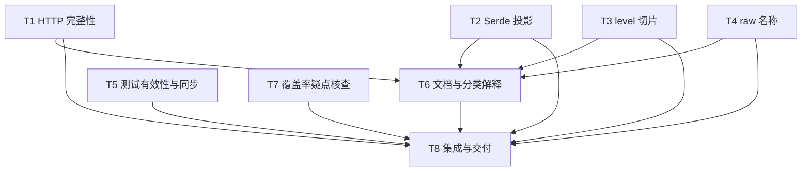

# rs-redact 本轮评审修复实施计划

> **面向智能体执行者：** 获得实施授权后使用 executing-plans 在当前会话按任务执行，各步骤使用复选框跟踪。若后续选择并行 agent，再使用 subagent-driven-development 并遵守下列互斥写入集合。本文不要求新建 Paseo workspace，不要求用户再次确认既定采纳范围。

**目标：** 以最小相关改动完成 RR-001—RR-008，并先核实 RR-V01、仅在证实后修复。

**架构：** 保留现有事务与发布模型。HTTP 传播截断事实，Serde view 使用实际借用 projection，旧源 Serialize 桥保持兼容；其余任务局部修正名称、测试及文档。

**技术栈：** Rust 2024、MSRV 1.94、Serde/serde_json/serde_test、syn/quote、现有 rs-infra 检查工具。

**设计依据：** [设计文档](design-20261024T182341563Z-554f7614.md)。项目根为 `/data/working/qubit/rust-common/rs-redact`，以下路径均相对该根。

**工作位置：** 两份交接文档使用用户指定 doc 路径，不创建技能默认临时 workspace；未来实验只使用可丢弃的外部 target/profile 目录，不存放或替代本计划。生成本计划不等于开始实施。

## 全局约束与用户取舍

- 本轮纳入 RR-001 至 RR-008，以及 RR-V01 的核查；无明确搁置或拒绝条目。用户未限定范围，本次按其命令的默认全部范围生成方案，没有虚构此前全局确认。
- 当前阶段仅生成两份文档，不修改源码、测试、脚本、已有文档或下游；以下步骤均供后续获实施授权后执行。
- 保留 facade → runtime/policy、domain/formats → runtime/policy 的现有职责分层，不建立第二套公开输出模型。
- 开启脱敏时，任何完成状态都不得发布未获准的原值；修正完整性元数据不能改用原值回退。
- 每次事务或同步 Serde scope 共用现有账本，不重复准入、不预序列化测量、不重置嵌套预算。
- 保持 UTF-8 边界、日志转义和现有 Serde 事件形状；不以最终字符串长度替代真实失败事实。
- 结构化 view 与源对象的普通 Serialize 是不同边界，不能为修复 view 能力而强制添加 `#[redact(serde)]`。
- RR-V01 未证实前不改覆盖率配置、阈值、排除项或相关测试命令。
- 仅修改评审条目直接涉及的实现、测试和对应文档；不做全库风格整理、文件迁移或无关去重。
- 未经用户明确要求，不执行 `git add`、`git commit`、`git push`；本计划不授权这些操作，也不授权删除重要文件。
- 保持 runtime 0.10.0、derive 0.8.1、MSRV 1.94 和现有 feature/dependency；本轮不升级、不发布。
- 已有 dirty 文件是 Cargo.toml、src/policy/redaction_policy.rs、src/runtime/redaction_handle_error.rs；实施前重读实际 diff，不覆盖用户变更。
- 修改 Rust 实现、注释、测试前分别读取 ~/.agents/specs/rust-coding.mdc、rust-comment.mdc、rust-test.mdc；确认缺陷修复读取 bug-fix.mdc；只有确需修改 Shell 或执行高风险命令时读取 shell.mdc。不得为此遍历其他规则。

## 条目映射

| 编号 | 范围 | 实施任务 | 集成验收 |
| --- | --- | --- | --- |
| RR-001 | query/form 掩码截断 | T1 | T8 |
| RR-002 | disabled 来源截断 | T1 | T8 |
| RR-003 | nested/Vec/Option projection | T2 | T8 |
| RR-004 | level slice | T3 | T8 |
| RR-005 | raw 名称 | T4 | T8 |
| RR-006 | 全局策略并发测试 | T5 | T8 |
| RR-007 | 三类无效断言 | T5 | T8 |
| RR-008 | 分类解释 Rustdoc | T6 | T8 |
| RR-V01 | 先核查后条件修复 | T7 | T8 |

## 调度图

下表并行批次表示可并行条件，不自动要求创建 agent 或 worktree。默认按当前会话顺序执行；没有提交授权，“最小解锁产物”指可审查且 focused 验证通过的文件差异，不要求提交。

| 任务 | 前置任务 | 最小解锁产物 | 写入集合 | 本地验证 | 集成验证归属 | 审查时机 |
| --- | --- | --- | --- | --- | --- | --- |
| T1（批次 A） | 无 | HTTP 截断回归与实现 | field_redactor.rs、form.rs、executor/{url,form_body,body}.rs、新 HTTP 回归 | http_completeness_regression_tests | T8 | 立即审查 |
| T2（批次 A） | 无 | 实际生命周期 projection 与兼容桥 | option_projection.rs、vec_projection.rs、新 forwarding/array/tuple projection、internal/mod.rs、derive serde/{entry,field}.rs、新 projection 回归 | projection_capability_regression_tests、projection_scope_tests、既有 generic fixture | T8 | 立即审查 |
| T3（批次 A） | 无 | slice level impl 与事件断言 | redact_level_serialize.rs、新 slice 回归 | level_slice_regression_tests | T8 | 立即审查 |
| T4（批次 A） | 无 | raw 名称生成与 token 回归 | derive serde/naming.rs、serde_container_attributes.rs、derive_identifier_regression_tests.rs | derive_identifier_regression_tests | T8 | 批量审查 |
| T5（批次 A） | 无 | 同步与合同断言 | application_default_tests.rs、derive_serde_runtime_tests.rs、derive_recursive_storage_tests.rs、new_api_tests.rs | 对应四个测试目标 | T8 | 批量审查 |
| T7（批次 A） | 无 | 覆盖率疑点结论；证实后隔离命令 | 条件修改三个 compile 测试与已存在 helper；新核查记录 | 受控 instrumentation 实验及对应 compile 测试 | T8 | 先审查证据，再条件修复 |
| T6（批次 B） | T1、T2、T3、T4 | 最终行为已稳定 | redaction_rules.rs、必要 policy rustdoc、双语 README/guide/design | focused policy tests 与文档差异核对 | T8 | 批量审查 |
| T8（批次 C） | T1、T2、T3、T4、T5、T6、T7 | 全部任务及核查结论 | 仅必要集成修正和交付记录 | 统一 CI/文档/coverage/下游检查 | T8 | 立即审查 |

资源组：普通 focused Cargo 使用组 cargo-main，同一 target 重型命令串行；如实际并行，每任务分配独立外部 CARGO_TARGET_DIR。T7 使用组 coverage-exclusive，不与其他 coverage 命令并行；T8 取得全部验证资源后统一运行昂贵门禁。并行任务不得同时编辑本表集合外的共享文件；跨任务问题先交回协调者。

## 任务拓扑依赖图



## T1：HTTP 完整性（RR-001、RR-002）

**修改：** `src/formats/http/field_redactor.rs`、`src/formats/http/internal/form.rs`、`src/formats/http/internal/http_policy_executor/{url,form_body,body}.rs`。
**新建测试：** `tests/http_completeness_regression_tests.rs`，仅在 http feature 下运行。
**接口：** 新增 HTTP 内部 `redact_bounded_with_truncation<'v>(&self, field: &str, value: &'v str, max_bytes: usize) -> (MaskedValue<'v>, bool)`；form 新内部方法返回 `(String, bool)`。不改公开 API，T6 依据最终 summary 行为写文档。

- [ ] 编写公开 API 回归：query 使用 x=Secret、MaskPolicy::fixed("界")、max_output_bytes=24；form 使用 a=Secret、MaskPolicy::fixed("😀")、max_output_bytes=2。URL 为 `https://example.test/?x=raw`，form body 为 `a=secret`，content-type 为 application/x-www-form-urlencoded。
- [ ] 每个 case 同时断言下列合同，分别覆盖 one-shot 与 batch，而不是只检查长度：

```rust
assert_ne!(output.summary().completion(), RedactionCompletion::Complete);
assert!(output.summary().reasons().contains(RedactionReason::OutputLimitReached));
assert!(output.complete_text().is_err());
assert!(!output.text().as_str().contains("raw"));
// 独立创建相同策略 batch，加入相同输入后发布：
assert_eq!(diagnostics.text(handle).as_str(), "<incomplete>");
```

- [ ] 添加 disabled 来源截断测试：`BodyCapture::truncated(b"prefix", 20)`，默认充足预算必须非 Complete 且有 SourceTruncated；另测来源+输出双截断、完整 body 正常 Complete，保留 redaction_disabled 与 usage。
- [ ] 运行 `cargo test --no-default-features --features http --test http_completeness_regression_tests`，确认错误来自目标断言而非网络或编译环境。
- [ ] 实现新 FieldRedactor 方法，使用现有 mask_bounded_with_truncation；既有文本方法委托新方法。form 与 query 显式合并 bool，写入拒绝后停止推进，保持现有转义与计量。
- [ ] disabled 分支构造 ParsedBody 后经过 finish_body_redaction，不重解析或重复准入，不引入伪解析错误。
- [ ] 重跑新目标及 `cargo test --no-default-features --features http --test http_ndjson_contract_tests --test http_session_transaction_tests`；预期全部通过，记录实际 completion/reasons，不硬编码错误的旧文本。

## T2：修复 projection 能力断层（RR-003）

**修改：** `src/domain/internal/{option_projection,vec_projection}.rs`、`derive/src/serde/{entry,field}.rs`。仅确实需要的生成器参数沿其直接调用链更新；不得迁移无关字段模式。
**按需新建实现：** `src/domain/internal/{projection_forwarding,array_projection,tuple_projection}.rs`，并在 `src/domain/internal/mod.rs` 声明与重导出；仅用于保留已有引用、Box/Rc/Arc、数组和 tuple 组合。
**新建测试：** `tests/projection_capability_regression_tests.rs`。
**接口：** `T: RedactSerializeSource + 'value` 与 `T::RedactedFields<'value>: Serialize`；元素适配为已有 RedactedProjectionRef。无新增面向业务的 trait，无全局 blanket bridge。

- [ ] 先以最小借用场景写正向测试并编译确认现状失败：

```rust
#[derive(Redact)]
struct Child<'a> {
    #[redact(level = "secret")]
    password: &'a str,
}
#[derive(Redact)]
struct Parent<T> {
    #[redact(nested)]
    child: T,
}
// 在测试函数内创建局部 String；分别构造 direct、Vec、Some、None 和 Parent。
// Child 不加 #[redact(serde)]，不派生普通 Serialize。
// 断言每种 view/to_json 的 password 都为 <redacted>，且局部借用合法。
```

- [ ] 加普通 Serialize 对照：源对象 Serialize 保留原值，redacted view 隐藏原值；添加既有 serde opt-in 的泛型/局部借用保护。补文本专用类型仍可 derive、仅结构化请求失败的 consumer fixture，并在已有编译测试入口注册，不依赖 fixture 自动发现。
- [ ] 运行 `cargo test --no-default-features --features derive,serde,json --test projection_capability_regression_tests`，记录 trait 失败位置。
- [ ] 将 Option/Vec 的 Serialize impl 改为实际 `'value` 投影约束，保留作用域检查与事件形状；遍历保持保存引用的实际生命周期。不得加入 `for<'a> T::RedactedFields<'a>: Serialize` 来代替实际借用条件。
- [ ] 对既有 Vec<Box<Child>>、Option<&Child>、Vec<[Child; N]>、tuple 嵌套补编译与事件回归；为旧支持集合提供 Source 转发或数组/tuple 投影，保留已有事件/预算，不扩展容器种类。搜索下游手写旧隐藏 trait 的调用；若存在，列明受影响者并验证 projection 或旧 adapter 迁移，不假称隐藏 bound 无兼容影响。
- [ ] 同步 named/unnamed nested 的 projection bounds 与 carrier；对源 hook 保留既有 legacy 能力。若不能直接委托新 projection，按设计第 5.2 节复用字段生成器的 legacy carrier/bounds 模式，不复制第二套遍历算法，不要求所有 Child 改 serde 属性。
- [ ] 运行新目标、projection_scope_tests、serde_event_contract_tests、derive_syntax_contract_tests、derive_serde_runtime_tests，使用 `--no-default-features --features derive,serde,json`；RR-006 同时未完成时，serde runtime 先加 `-- --test-threads=1`，并在 T8 恢复并发验收。
- [ ] 保留已有未作用域隐藏 adapter 失败、空容器错误、递归泛型与 borrowed fixture 的编译证据；普通根、Vec、Option、nested 四条路径全部满足新能力合同后解锁 T6。

## T3：level 借用切片（RR-004）

**修改：** `src/domain/internal/redact_level_serialize.rs`。
**新建测试：** `tests/level_slice_regression_tests.rs`。
**接口：** `impl<T: RedactLevelSerialize> RedactLevelSerialize for [T]`，保留 trait 的现有方法签名。

- [ ] 新建借用字段 fixture：`#[redact(level = "secret")] values: &'a [String]`；断言文本、view 和 to_json 均隐藏叶子，局部数组与 Vec 借用不要求复制。
- [ ] 加入空切片、`&[&str]`、Low/Medium/High/Secret/disabled 表示，serde_test 的 Seq/SeqEnd 事件，并保留固定数组 Tuple 事件的对照。
- [ ] 运行 `cargo test --no-default-features --features derive,serde,json --test level_slice_regression_tests`，确认先因切片能力缺失失败。
- [ ] 以 Vec 的 serialize_structured/集合准入模式实现切片，serialize_seq(Some(self.len())) 后逐项使用 RedactedLevelSerializeRef；拒绝使用现有安全替代，不修改数组 tuple 实现。
- [ ] 添加集合、深度、输入、logical payload 小预算边界；断言不泄露、只遍历一次、无独立账本。
- [ ] 重跑新目标及 `cargo test --no-default-features --features derive,serde,json --test serde_event_contract_tests`；通过后交 T6 同步支持说明。

## T4：raw 名称兼容性（RR-005）

**修改：** `derive/src/serde/naming.rs`、`derive/src/attributes/serde_container_attributes.rs`、`tests/derive_identifier_regression_tests.rs`。
**接口：** 变体默认名称先 unraw 再 rename_all，容器默认名称 unraw；显式 rename 字符串原样保留。

- [ ] 以 `enum Kind { r#type }` 写外部、内部、相邻标签对照，预期默认名称 type、UPPERCASE 名称 TYPE；显式 rename 为 r#type 时仍保留该字符串。fixture 精确配置 serde 表示所需字段形状。
- [ ] 用 serde_test token 断言 raw 类型名传给 Serializer 的名称，加入原生 serde::Serialize 对照，不以 JSON 忽略容器名掩盖错误。
- [ ] 运行 `cargo test --no-default-features --features derive,serde,json --test derive_identifier_regression_tests`，确认生成名称不符。
- [ ] 两处默认名使用 syn::ext::IdentExt::unraw 或现有等价 helper；核对 named_content_proxy 的 raw variant 拼接并修复同根因的生成标识符，不更改显式 rename。
- [ ] 重跑目标及 `cargo test --no-default-features --features derive,serde,json --test derive_serde_enum_representation_tests`；保证已有字段/keyed_by collision 用例通过。
- [ ] 向 T6 交付输出变化说明：旧错误 wire 名可用显式 rename 保持，不自动迁移下游数据。

## T5：测试同步与有效性（RR-006、RR-007）

**修改：** `tests/{derive_serde_runtime,application_default,derive_recursive_storage,new_api}_tests.rs`。
**接口：** 生产接口不变；所有同测试二进制内依赖可变 application default 的目标测试使用同一 APPLICATION_DEFAULT_LOCK。

- [ ] 在 test_deserialize_only_bounds_preserve_redacted_serialization 的源 Serialize 调用前取得同文件锁；核对同文件其他源 Serialize 测试与替换默认策略测试是否遵守同一锁。保留源 Serialize 检验，不用 view 替换掉它。
- [ ] composer 测试安装确定的旧 custom_probe=Secret 策略后创建 composer，再替换为允许该字段的新策略；旧 composer 输出 <redacted>，新 composer 输出 visible，均应 Complete。测试结束恢复之前默认策略，避免依赖测试启动时全局状态。
- [ ] 递归存储测试改为观察 Redactor::standard().redact_text(&value)，断言字段结构和值；普通 Debug 输出不能成为通过依据，保持 derive-only 可运行。
- [ ] reasons 测试补齐 FormattingFailed，对每一对 inserted/candidate 使用：

```rust
assert_eq!(
    RedactionReasons::empty().with(inserted).contains(candidate),
    inserted == candidate,
);
```

- [ ] 另断言 union 的精确成员，保留全部 12 个 reason 枚举；不修改当前正确的位分配。
- [ ] 运行 `cargo test --no-default-features --features derive --test application_default_tests --test derive_recursive_storage_tests --test new_api_tests`。
- [ ] 对 serde runtime 运行 `cargo test --no-default-features --features derive,serde,json --test derive_serde_runtime_tests -- --test-threads=1`，再用 8 线程重复运行 20 次（由执行器循环调用命令，保存每次退出码）；串行验证基准、多线程验证隔离。未观察到旧偶发失败不能推翻已确认的无锁交错。

## T6：Rustdoc 与双语说明（RR-008 及修复文档）

**修改：** `src/policy/field/redaction_rules.rs`、必要时 `src/policy/redaction_policy.rs` 的直接相关 Rustdoc；`doc/{user_guide,user_guide.zh_CN,design,design.zh_CN}.md`；只有受影响时修改根与 derive 的双语 README。
**接口：** 无算法或公共 API 变化。

- [ ] 用现有测试 tests/policy/redaction_policy_tests.rs 的重叠规则案例核对构造 API；在 classify_field Rustdoc 增加可编译公共 API 示例，关闭 floor 后对 OPENAI_ACCESS_TOKEN 展示首匹配 Medium 与最终 Secret 的差异。
- [ ] 文案明确首匹配解释不等于最终保护，即使不涉及 floor 也可能不同；保持 allow 和 strongest 合并规则原样，不修改它们的实现。
- [ ] 根据 T1—T4 实际结果，同步双语指南与设计中的截断原因、投影能力、slice sequence/array tuple、raw 名称兼容说明。源普通 Serialize 既有桥的能力范围不得被写成与新 view projection 完全等价。
- [ ] 运行 `cargo test --no-default-features --test policy_tests`，确认既有策略合同未受影响；若示例采用的 feature 非空，在示例旁正确注明依赖。
- [ ] 人工逐条核对双语含义、相对路径、公开符号；文档示例实际编译执行和 Rustdoc 检查统一交 T8，不在叶子重复跑全库文档门禁。

## T7：覆盖率疑点先核查（RR-V01）

**初始状态：** 待验证，非已确认缺陷。
**核查文件：** `.infra/bin/coverage.sh`、`.infra/bootstrap.sh`、当前实际使用的 infra coverage 实现、`tests/support/isolated_cargo.rs`、`tests/{public_api_compile,feature_gate_compile,map_api_compile}_tests.rs`。
**条件写入：** 上述三个 compile 测试；helper 仅在确有必要时调整。核查结果保存在 `doc/verification-rr-v01-20261024T182341563Z-554f7614.md`，后续阶段新建且不得覆盖已有文件。

- [ ] 检查实际 coverage 工具和 wrapper 注入方式；记录版本及配置，不从 helper 注释直接得出污染结论。
- [ ] 使用独立临时 target/profile 路径运行一个受控隔离 fixture；记录父子相关变量是否存在、wrapper 是否执行、profile 是否进入父 report 的输入集合，只记录所需变量名和非敏感事实。
- [ ] 设置决策门槛：同时证明 instrumentation 传递与无归属 profile/报告异常，才将本项转为确认并修复；不满足时记录未证实或不适用，不改代码；工具缺失则记录未完成及原因，不伪报完成。
- [ ] 证实后，用 `support::isolated_cargo::command(OsStr::new(env!("CARGO")))` 替换对应构造，保留 `.args(...)`、`.current_dir(...)`、feature、offline 和原诊断断言。不要把网络解析失败计为 API 拒绝。
- [ ] 核对 helper 自带环境默认值，调用者显式保持原测试 offline/联网语义；仅迁移相同证据链涉及的隔离 Cargo 测试。
- [ ] 证实分支运行 `cargo test --no-default-features --features derive,serde,json,http,uri --test public_api_compile_tests --test feature_gate_compile_tests --test map_api_compile_tests`，并重复受控实验，确认 profile 归属问题消失。未证实分支保留未修改差异证据。
- [ ] 写入核查记录：环境、命令、退出码、profile 事实、确认/未证实结论、修改与否及依据。最终 coverage 仍由 T8 统一负责，不通过降低阈值或排除文件解决。

## T8：统一集成验证与交付

**输入：** T1—T7 的差异、focused 结果及 RR-V01 核查结论。
**输出：** 条目级完成记录、最终验证输出、剩余限制。不得凭本计划预期宣称通过。

- [ ] 检查 git status/diff，确认只修改任务直接相关内容；保留实施前 dirty 内容。记录 T1—T7 实际写入路径，检查无意格式化、下游持久修改、依赖或版本漂移。
- [ ] 运行项目固定格式流程 `./.infra/bin/align-ci.sh`；先检查工具及其清理影响。若带来无关变更，只恢复本轮工具产生且能明确识别的部分，不能用整文件回退覆盖用户工作。相关 Rust 差异重新审查。
- [ ] 统一运行 `./.infra/bin/ci-check.sh`，由其读取现有 cargo-matrix.json 执行项目配置门禁。记录实际 check/test/doc/clippy/coverage/fuzz/package 任务和退出码；确认包括全部 28 种 runtime feature 集、derive、Rustdoc/doctest、独立 fuzz 编译与配置 smoke。若工具未实际覆盖某项，只补跑缺项，不重复全部通过检查。
- [ ] 统一运行 `python3 -B scripts/check_doc_examples.py`，验证双语根 README 和指南代码；derive README 受修改的片段在临时 consumer 编译。测试消费者临时 target 与源码分离，不修改发布 manifest。
- [ ] 覆盖率必须使用现有阈值和无文件豁免配置。已有 CI 已收集则复用该证据；若未收集，执行 `./.infra/bin/coverage.sh`。RR-V01 的未证实状态不能写成“覆盖率污染已修复”。
- [ ] 以当前检出的 rs-http、rs-command、rs-value 作受控下游检查：先验证其锁文件实际解析到本次源码，再运行相关 redaction 测试；如版本解析未指向本次源码，通过临时 consumer 的 path 依赖或受控 Cargo patch 覆盖，不永久修改下游配置，不把 registry 旧版本测试当本次验证。
- [ ] 汇总 RR-001—008：实际变更、失败回归及通过证据、兼容影响；RR-V01 单列核查结论。源码确认但未运行复现的历史不能当作 red/green 证据。
- [ ] 最终交付说明 raw 名称输出变化及显式 rename 迁移、HTTP 完整性修正导致 fallback 变化；给出实际验证范围和任何未完成事项。未经授权不暂存、提交、推送或发布。

## 自检与完成条件

- [ ] 调度表、Mermaid 与任务正文的 ID 完全一致：T1、T2、T3、T4、T5、T6、T7、T8。
- [ ] 每个 RR 条目均有明确任务和验收；无用户拒绝项混入，无评审之外的全库整理。
- [ ] T2 保留文本专用派生、局部借用、源 Serialize opt-in、缺 scope 失败和事件形状，不能仅以一个 owned Child 测试通过验收。
- [ ] T1 输出拒绝有 reason，来源拒绝有真实 provenance，batch/one-shot 共享同一修复。
- [ ] 所有重型门禁仅由 T8 负责；T7 的受控实验是核查疑点必需的例外，使用独立资源。
- [ ] 所有命令以上述目录为工作目录；实施结果附真实退出码。依赖或工具失败须作为环境问题报告，不算目标回归。
- [ ] 当前文档阶段到此结束，生产修复与验证命令尚未执行。未来只有获得实施授权后才勾选执行步骤。
