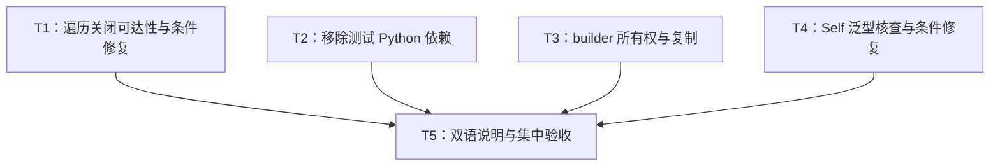

# rs-redact 本轮评审改进实施计划

> **面向智能体执行者：** 使用 executing-plans 按任务推进，各步骤使用复选框跟踪。本计划提供独立任务的并行条件；具体执行方式按下一阶段指令与适用技能确定。

**目标：** 闭环 REDACT-001—004，以证据决定两项条件修复，消除测试外部依赖和 builder 冗余复制。

**架构：** 保留现有 facade/runtime/formats/domain/derive 分层，仅修正相关预算预检、测试和所有权处理。公开 API、wire format、feature 默认值及预算含义保持现状。

**技术栈：** Rust 2024、Rust 1.94、Cargo、Serde、syn、trybuild、toml。

**项目根：** `/data/working/qubit/rust-common/rs-redact`。

**设计依据：** [本轮设计](design-20261028T152742097Z-8a2ddb39.md)。文档按用户指定保存在项目 doc 目录，不另建临时文档工作区。

## 范围和长期要求

- 纳入 REDACT-001、REDACT-002、REDACT-003、REDACT-004；没有用户明确搁置或拒绝项。
- REDACT-001 的公开可达影响已降为待验证；原“超长 field 后追加 env”例子有根准入保护，不能用它预设失败。REDACT-004 仍为疑点，必须先验证。
- 仅修改与任务直接相关内容，不顺手重构、格式化或清理。
- CI 只负责验证当前 crate 自身；不得加入或保留 downstream all-features 测试。
- 使用当前 Paseo workspace，不创建或打开新的 Paseo workspace。
- 实施前核对现有改动，保留用户工作。修改源码、测试、Rustdoc 时按用户 AGENTS.md 读取对应按需规则。
- Rust 1.94、edition 2024、默认 feature 为空；不升级生产依赖、不主动改变公开签名。
- 当前方案阶段以两份文档交付结束。未来代码修改、验证、提交和推送遵循届时实施命令授权，不沿用方案阶段边界，也不由本计划擅自增加 Git 授权。

## 调度图

T1—T4 写入集合不相交，属于同一可并行批次，前置检查可在各任务开始时独立执行。它们不要求先提交才解锁，保留原工作树与用户改动即可。所有 Cargo 重型命令属于资源组 CARGO，使用同一 target 时串行；确需并行时用互不重叠的 target 目录。T5 独占全量验证和公共文档集成。

| 任务 | 前置任务 | 最小解锁产物 | 写入集合（项目相对路径） | 本地验证 | 集成验证归属 | 审查时机 |
| --- | --- | --- | --- | --- | --- | --- |
| T1 | 无 | REDACT-001 可达性结论及必要回归/修复 | `src/runtime/structural_budget.rs`、`src/runtime/runtime_core.rs`、`tests/transaction_session_tests.rs`、必要时新增 `src/tests/runtime/preflight_closed_tests.rs` 并接入其 `mod.rs` | `cargo test --locked --test transaction_session_tests`；新增内部测试时按名称过滤 | T5 | 立即审查证据，之后才决定生产修改 |
| T2 | 无 | Rust TOML 路径往返测试 | `Cargo.toml`、`Cargo.lock`、`tests/manifest_encoding_tests.rs` | `cargo test --locked --test manifest_encoding_tests` | T5 | 批量审查 |
| T3 | 无 | 同签名 owned builder 与行为回归 | `src/policy/redaction_policy_builder.rs`、`src/policy/redaction_rules_builder.rs`、`tests/policy/fields_builder_tests.rs`、`tests/policy/redaction_policy_tests.rs`、`tests/http/http_policy_builder_tests.rs`、`tests/uri/uri_policy_builder_tests.rs` | `cargo test --locked --features http,uri --test policy_tests --test http_tests --test uri_tests` | T5 | 立即审查所有权与错误语义 |
| T4 | 无 | REDACT-004 原生对照及条件修复 | `derive/src/serde/entry.rs`、必要时 `derive/src/serde/source_function_path.rs`、`tests/fixtures/pass/adapter_self_type_argument.rs`、`tests/derive_compile_tests.rs` | `cargo test --locked --features derive,serde,json --test derive_compile_tests test_pass_fixtures -- --exact` | T5 | 立即审查复现与泛型边界 |
| T5 | T1、T2、T3、T4 | 全部条目结论、集成 diff 与验证记录 | `doc/user_guide.md`、`doc/user_guide.zh_CN.md`；对应承诺存在时改 `doc/design.md`、`doc/design.zh_CN.md`、`derive/README.md`、`derive/README.zh_CN.md`；本计划勾选与本轮设计事实更新 | 文档示例及集中项目验证，见 T5 | T5 唯一负责 | 立即审查 |

## 任务拓扑依赖图



## T1：遍历关闭的真实影响与条件修复（REDACT-001）

**输入：** 现有 `RuntimeSession` 与公开 composer/batch/domain API。**输出：** 有实际证据的结论；若需要修复，只增加 crate 内关闭状态查询，不改变公开接口。

- [ ] 核对基线和规则，完整追踪根准入、frame 截断、循环预检、next、正式准入。重点路径包括 `src/runtime/format_admission.rs`、`src/formats/env/admission.rs`、argv/env inspection、process admitted iterators、domain fields/items/entries。禁止把循环内缺少 guard 单独当作公开故障。
- [ ] 在 `tests/transaction_session_tests.rs` 先加入“超长字段后追加 env/argv”的计数测试，预期可能已经通过，记录根节点准入的保护。使用 `max_key_bytes(4)`、长度为 5 的 key，保留足够其他额度；避免测试被 output 或 node 耗尽遮蔽。计数器放进真实输入 iterator 的 next；其 size_hint 返回 `(0, None)`，不伪造空迭代器。

测试迭代器可采用以下模式（在测试内构造，保持计数器借用有效）：

```rust
let calls = std::cell::Cell::new(0usize);
let pairs = std::iter::from_fn(|| {
    let previous = calls.replace(calls.get() + 1);
    assert_eq!(previous, 0, "unexpected repeated access after rejection");
    Some((std::ffi::OsStr::new("MODE"), std::ffi::OsStr::new("safe")))
});
// 将 pairs 交给待测的公开 env 操作，操作必须由前序拒绝终止。
// 完成事务后精确断言 calls.get() == 0；错误实现反复读取时会立即 panic。
```

- [ ] 实际回归使用有限计数器或“最多返回一次、第二次 panic”迭代器，分别测试 composer、batch 与可观察的 domain scope。对已通过场景保留真实结果，不虚构失败。
- [ ] 运行 `cargo test --locked --test transaction_session_tests`。若存在失败，确认只因关闭后触发 next，而非 fixture 生命周期、类型或环境错误。
- [ ] 若公开路径始终被保护，记录逐路径证据，撤回公开行为缺陷结论；不改生产代码，只保留有独立回归价值的测试。
- [ ] 若确认公开缺口，先保留真正失败用例，再在 StructuralBudget 增加如下只读接口，并补其英文语义文档：

```rust
pub(crate) const fn traversal_is_closed(&self) -> bool {
    self.traversal_closed
}
```

在 RuntimeCore 两个预检开头检查该状态，关闭时沿用现有 `RedactionSummary::truncated(RedactionReason::TraversalLimitReached)` 记录方式并返回 false；保留开放状态的全部检查。仅在确实需要访问 crate-private 合同时新增内部测试文件，并在 `src/tests/runtime/mod.rs` 注册，不增加 test hook。

- [ ] 复跑 focused 测试；验证 closed 检查不收费，不重开遍历，深度拒绝仍能按原合同继续。立即审查可达性和修改范围后交 T5。

## T2：自包含 TOML 往返测试（REDACT-002）

**输入：** `support::manifest::toml_string`。**输出：** 同一批路径的 parser 往返断言，普通 Cargo 测试不启动 Python。

- [ ] 阅读当前测试与锁文件 TOML 条目，在修改前记录 Python 子进程依赖。此任务不要求为了证明已知依赖故意卸载 Python 或破坏 PATH。
- [ ] 在 `[dev-dependencies]` 添加 `toml = "1.1.6"`，只更新根包关联的锁文件依赖记录，保留已有解析版本。首次更新锁文件的 Cargo 命令不带 `--locked`；检查 diff 后后续统一使用 `--locked`。若当前环境无法解析该已锁版本，先判断缓存/registry 问题，不顺带升级依赖。
- [ ] 保留现有五个 value，将子进程部分替换为真实 TOML 解析与逐项比较；测试函数改名说明 Rust TOML parser：

```rust
let parsed: toml::Value = manifest
    .parse()
    .unwrap_or_else(|error| panic!("invalid generated TOML {manifest:?}: {error}"));
let actual = parsed
    .get("dependencies")
    .and_then(|value| value.get("fixture"))
    .and_then(|value| value.get("path"))
    .and_then(toml::Value::as_str)
    .expect("fixture.path must remain a TOML string");
assert_eq!(actual, value, "generated manifest: {manifest:?}");
```

- [ ] 移除本文件不再需要的 io/process import 和中转 JSON 解析，其他测试 helper 不动。
- [ ] 运行 `cargo test --locked --test manifest_encoding_tests`，预期全部五类输入精确往返。检查此测试源文件没有 Python 命令调用；不要误称整个 CI 已无需 Python。交 T5。

## T3：owned builder 与规则重建（REDACT-003）

**输入：** 现有 consuming builder API 与 immutable policy。**输出：** 相同签名和公开行为，移除全量 draft clone 和重复规则 clone。

- [ ] 核对 `fields/http/uri` closure view、错误锁存、`from_inner` 所有调用方。记录已有 `Cargo.toml` 和源码改动，避免任务回写覆盖它们。
- [ ] 复用既有公共测试，必要时增加一个组合配置回归：原 policy 经 to_builder 编辑 fields 后保留 floor/matching/allow/unknown fallback，以及启用 feature 下的 HTTP/URI 配置；显式 clone 出的另一 builder 和原 policy 均保持原值。对无效 fields/http 断言实际 PolicyError，不将已消费变量的不可访问状态当运行时断言。
- [ ] 将三个方法内 `let mut draft = self.clone();` 改为 `let mut draft = self;`，保留原有剩余流程，不改变 API 签名。无需为这一内部优化增加必然先失败的镜像实现测试。
- [ ] 添加 `from_owned(inner: RedactionPolicyInner, location: PolicyLocation) -> Self`，移动 inner 集合与配置字段；保留 from_inner，委托 from_owned(inner.clone(), location)。from_policy 调用 from_owned(policy.rules().clone_application(), PolicyLocation::Rules)，从两轮集合 clone 降为一轮。
- [ ] 修正相关英文 Rustdoc，说明调用消耗 builder、失败不返回它、无效策略不会发布。向 T5 提供双语文档中需要替换的“prior builder unchanged”语句定位。
- [ ] 运行 `cargo test --locked --features http,uri --test policy_tests --test http_tests --test uri_tests`。确认错误、floor 和 namespace 行为不变；审查 diff 证明移除了冗余 clone，不写未经测量的提速百分比。交 T5。

## T4：Self 类型实参的原生对照与条件修复（REDACT-004）

**输入：** 现有 source_function_path rebind 与 adapter helper 泛型分析。**输出：** 原生对照、可执行正向 fixture；只有确认后才改生成器。

- [ ] 使用实际文件 `derive/src/serde/source_function_path.rs`，不要沿评审答复错误链接创建 `serde/internal/` 目录。读取 helper 泛型筛选及 Self rebind 的完整逻辑。
- [ ] 在新 fixture `tests/fixtures/pass/adapter_self_type_argument.rs` 建立原生 Serde 对照与 Redact 源/view 测试，基础模型如下；main 中实例化 `Record::<u8>` 并精确断言输出为 `{"value":42,"marker":null}`，再建立等价原生 Serde 类型比较：

```rust
use std::marker::PhantomData;
use qubit_redact::Redact;
use qubit_redact::Redactor;

fn encode<C, S: serde::Serializer>(value: &u32, serializer: S) -> Result<S::Ok, S::Error> {
    let _ = std::mem::size_of::<C>();
    serializer.serialize_u32(*value + 1)
}

#[derive(Redact)]
#[redact(serde)]
struct Record<T> {
    #[serde(serialize_with = "encode::<Self, _>")]
    value: u32,
    marker: PhantomData<T>,
}

#[derive(serde::Serialize)]
struct Native<T> {
    #[serde(serialize_with = "encode::<Self, _>")]
    value: u32,
    marker: PhantomData<T>,
}

fn main() {
    let native = Native::<u8> { value: 41, marker: PhantomData };
    let source = Record::<u8> { value: 41, marker: PhantomData };
    let expected = serde_json::json!({"value": 42, "marker": null});
    assert_eq!(serde_json::to_value(&native).unwrap(), expected);
    assert_eq!(serde_json::to_value(&source).unwrap(), expected);
    let redactor = Redactor::standard();
    assert_eq!(serde_json::to_value(redactor.redact_view(&source)).unwrap(), expected);
    let encoded = redactor.to_json(&source).unwrap();
    assert_eq!(serde_json::from_str::<serde_json::Value>(&encoded).unwrap(), expected);
}
```

- [ ] 将 fixture 接入 `tests/derive_compile_tests.rs::test_pass_fixtures`。先独立确认原生 Serde 等价模型是否支持，再运行 `cargo test --locked --features derive,serde,json --test derive_compile_tests test_pass_fixtures -- --exact`。trybuild pass 会运行 main，因此断言必须真实执行；同时验证源 Serialize、view Serialize、to_json 三个入口。
- [ ] 若未复现或原生对照同样不支持，记录结论，不将 registry/编译环境故障当泛型缺陷，不做推测性生产修复。
- [ ] 若复现 helper 缺少 T/where predicate，使用 syn 的结构递归检查适配器路径中的类型 Self。优先在 source_function_path.rs 维护与 rebind 相同的受支持 AST 形态，避免字符串匹配；entry.rs 根据检测结果选择完整 source generics 或原精确筛选分支。
- [ ] 保持完整源泛型的 fresh identifier/lifetime 和 carrier 参数传递；不得对所有适配器无条件复制源泛型。扩大 fixture 以覆盖带生命周期/const 的源类型和嵌套 Self 类型实参，并用已有 adapter_path_generics 保护无关参数不会泄漏为额外 bound。
- [ ] 复跑 focused fixture 以及现有 Self path/predicate/泛型适配器用例，立即审查失败证据和 AST 边界后交 T5。

## T5：双语说明与集中验收

**输入：** T1—T4 的代码差异和实际结论。**输出：** 四项逐项关闭状态、对应证据和最小最终 diff。T1/T4 证伪也是合法完成结果，必须明确记为未修复且无需修复，不能写成已修复。

- [ ] 更新用户指南中 builder 的错误所有权说明，中英文语义一致；检查常驻设计文档是否有同样承诺，仅修对应段落。T4 确认并修复后才按实际能力补充相关说明，不宣称任意 Self 表达式均支持。
- [ ] 核对 rs-http、rs-command、rs-value、rs-fs 相关调用的签名兼容性，采用只读检查。没有 API 改变时不新增下游修改任务，不把 downstream all-features 测试加入 CI。
- [ ] 检查最终 diff 与用户初始改动，确认无无关格式变化、重命名、文件删除和依赖升级。若本地 alignment 会修改无关文件，先采用项目支持的限定范围方式；不能覆盖用户未保存或未提交工作来恢复整洁。
- [ ] 阅读当前 `.infra/bin/align-ci.sh`、`.infra/bin/ci-check.sh`、`.infra/ci/ci.toml` 和 project hook 的实际行为后，按项目要求统一格式与检查。下列为下一阶段集成命令，当前方案阶段未执行：

```bash
./.infra/bin/align-ci.sh
./.infra/bin/ci-check.sh
```

- [ ] 单一集成执行者确认该项目入口实际覆盖当前 workspace 编译/测试、28 组 feature 闭包、Clippy、严格 Rustdoc/doctest、双语示例、独立 fuzz、coverage 及项目配置的其余检查；保留退出码和原始失败原因。若入口没有覆盖某项，按其配置补运行一次对应命令，不重复已通过全量矩阵。双语示例入口为 `python3 -B scripts/check_doc_examples.py`，仅当项目入口未执行时补跑。
- [ ] 确认 `clippy::double_must_use` 等适用门禁由真实 Clippy 验证，而非普通 cargo check。coverage 维持函数至少 95%、行和 region 严格大于 90% 的项目要求，不降低阈值、不增加豁免。
- [ ] 对 T1/T4 逐项记录复现或证伪、最小修复或不修改的原因；T2 记录无 Python 调用的路径往返结果；T3 记录同签名配置行为与复制消除证据。把实际结果写回本轮文档的完成记录，保留原设计与事实修正脉络。
- [ ] 完成审查并交付变更范围、测试结果、未验证限制和下游兼容结论；Git 操作依届时实施授权执行，不从计划中的交付步骤推断提交或推送许可。

## 需求覆盖与交付自检

| 必须项 | 对应任务 | 完成证据 |
| --- | --- | --- |
| REDACT-001 不沿用错误触发链；先验证后修复 | T1 | 全链路、next 次数、条件修复或撤回结论 |
| REDACT-002 保持全部路径往返并消除 Python 子进程 | T2 | TOML 精确断言、focused 退出码、依赖 diff |
| REDACT-003 消除两类 clone，保留签名与错误语义 | T3 | owned 构造、policy 测试、英文 Rustdoc |
| REDACT-004 原生对照、Self 泛型核查与条件修复 | T4 | fixture 编译/main 结果、AST 边界、既有用例 |
| 双语说明一致、当前 crate CI、下游无强制迁移 | T5 | 文档对照、统一验收、只读调用方检查 |
| 保留用户工作与已明确范围 | T1—T5 | 基线比较及最终相关文件 diff |

调度表、拓扑图和任务正文使用相同的 T1—T5。计划生成时所有复选框均未执行，不把设计中的预期结果记作测试通过。

## 实施执行记录（2026-10-28）

- **T1 — 完成，结论为未证实公开缺陷。** 追踪 composer、batch、env/argv、process 与 domain scope 的根准入、frame 截断和惰性访问顺序。新增的三个计数回归确认拒绝后没有推进后续 argv/environment，也没有调用后续 domain 字段 accessor；未修改生产代码。`cargo test --offline --manifest-path /data/working/qubit/rust-common/.worktrees/rs-redact/impl-20261028/Cargo.toml --test transaction_session_tests`：退出码 0，16 项通过。
- **T2 — 实现完成。** 路径测试改用直接 dev-dependency `toml = "1.1.6"`，保留五类路径输入并逐项比较 parser 输出，删除 Python 子进程与 JSON 中转。`cargo test --offline --manifest-path /data/working/qubit/rust-common/.worktrees/rs-redact/impl-20261028/Cargo.toml --test manifest_encoding_tests`：退出码 0，1 项通过。普通 Cargo 测试不再调用 Python。
- **T3 — 实现完成，feature 验证未完整。** consuming builder 直接移动 `self`；`from_owned` 移动规则集合，`from_inner` 保持借用签名；同步 Rustdoc 和双语指南。`cargo test --offline --manifest-path /data/working/qubit/rust-common/.worktrees/rs-redact/impl-20261028/Cargo.toml --test policy_tests`：退出码 0，99 项通过。计划中的 `http,uri` focused 命令退出码 101，尚未进入测试；当前本地 `rs-json` 0.12.0 依赖本地 `rs-budget` 0.9.1，而目标 crate 直接依赖 registry `qubit-budget` 0.10.0，导致 JSON 类型不兼容。
- **T4 — 修复已实现，Serde 路径通过，JSON 路径未验证。** 原生 Serde 对照可编译运行；修复前 Redact fixture 复现 E0401，原因是适配器 `Self` 类型实参所需源泛型未进入 helper。生成器现在递归检测受支持的类型 AST 并在命中时保留 source generics；fixture 覆盖嵌套 `Option<&Self>`、生命周期、类型与 const 泛型。修复后 `cargo test --locked --manifest-path /data/working/qubit/rust-common/.worktrees/rs-redact/impl-20261028/Cargo.toml --features derive,serde --test derive_compile_tests test_pass_fixtures -- --exact`：退出码 0，29 个 pass fixture 通过。计划中的 `derive,serde,json` 命令退出码 101，受同一 `rs-json`/`qubit-budget` 版本不兼容阻断；因此 `to_json` 分支没有执行。
- **T5 — 文档已更新，集中验收未通过。** 用户指南中英文已改为说明 consuming builder 的错误所有权语义。`align-ci.sh` 的 Rust 风格阶段通过，随后 Clippy 退出码 101；`ci-check.sh` 同样在 Clippy 阶段退出码 101，CI 后续矩阵、coverage、fuzz 和 package 检查未运行。`python3 -B scripts/check_doc_examples_tests.py`：退出码 0，20 项通过；`python3 -B scripts/check_doc_examples.py`：退出码 1，运行示例在同一 JSON/budget 依赖冲突处编译失败。当前验证阻塞归因为本地 sibling 依赖版本不一致，不将其记录为本轮代码故障或通过。
- **提交：** `c094c74`、`b68f87f`、`8fdb0a4`、`3a20495`，按 T1—T4 分组。指定设计文档与本实施计划始终未加入暂存或提交。

上述 2026-10-28 记录在当时的旧 worktree 中形成，后续规范项目路径验证已完成；具体更正见下方“阻塞解除与最终验收”。

## 阻塞解除与最终验收（2026-10-29）

- **根因更正：** 失败不是规范项目中的依赖版本不兼容。实现 worktree 位于 `rs-redact` 子目录下的 `.worktrees`，其 `../rs-json`、`../rs-budget` 相对依赖落到了陈旧的 sibling worktree（rs-json 0.12.0 / qubit-budget 0.9.1）。将命令显式指向 `/data/working/qubit/rust-common/rs-redact` 后，自然解析到同一 workspace 的当前 sibling 仓库，依赖图兼容；未修改下游仓库。
- **重新验证：** 在规范路径运行 `cargo test --locked --manifest-path /data/working/qubit/rust-common/rs-redact/Cargo.toml --features derive,serde,json --test derive_compile_tests test_pass_fixtures -- --exact`（29 个 pass fixture 通过，含 `adapter_self_type_argument` 和 `to_json`）；运行 `cargo test --locked --manifest-path /data/working/qubit/rust-common/rs-redact/Cargo.toml --features http,uri --test policy_tests --test http_tests --test uri_tests`（policy 102、HTTP 46、URI 19 项通过）。
- **依赖更新：** 用户要求升级依赖后，分别运行根 crate 和 fuzz crate 的 `cargo update`，更新至当前 Rust 1.94 工具链兼容的最新锁定版本；变更仅在 `Cargo.lock` 和 `fuzz/Cargo.lock`。
- **格式与完整 CI：** `/data/working/qubit/rust-common/rs-redact/.infra/bin/align-ci.sh` 成功。随后 `/data/working/qubit/rust-common/rs-redact/.infra/bin/ci-check.sh` 成功，覆盖 workspace 默认测试、28 个 feature 闭包、Clippy、Rustdoc/doctest、74 条双语文档示例、8 个 fuzz smoke target、两个 crate package verify、coverage（functions 97.96%、lines 94.22%、regions 92.94%，均达阈值）及 advisory audit。package 验证出现 workspace patch 未使用的 Cargo warning，命令仍以成功结束；无失败检查。
- **提交与分支同步：** 原 T1—T4 提交及本次依赖更新、现存工作区修改和四份设计/计划文档均依用户后续明确指示提交。文档保留在磁盘。本轮之后续记录不会删除原始设计脉络或把旧的阶段性失败伪装成未发生。
