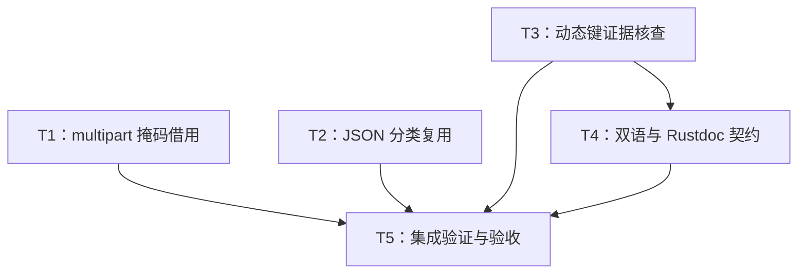

# rs-redact 本轮改进实施计划

> **面向智能体执行者：** 使用 executing-plans 逐项执行；如届时执行流程明确要求并行代理，可按下述调度图分工。所有步骤使用复选框跟踪，不能把本计划视为代码已修改或测试已通过。

**目标：** 完成本轮 RR-01、RR-02、RR-03，并以实验证据核查及处置 RR-04。

**架构：** 沿用现有事务、预算、格式执行器和公共入口。multipart 借用掩码，JSON 同引用复用分类；文档同步解释自动递归，动态键保持证据门控。

**技术栈：** Rust 1.94 / edition 2024、Cargo、Serde/serde_json、Criterion、现有分配计数及文档验证脚本。

**项目根目录：** `/data/working/qubit/rust-common/rs-redact`。以下路径和命令均相对此根目录。

**设计依据：** [本轮设计](design-20261031T063327244Z-19852fce.md)。

**文档位置说明：** 用户指定直接保存到项目 doc，本计划不使用临时方案目录，也不要求创建新的 Paseo workspace。

## 全局范围、授权与约束

纳入 RR-01（P2 已确认）、RR-02（P2 已确认）、RR-03（P3 已确认）、RR-04（P2 待验证）。没有用户明确排除、搁置或拒绝的条目。RR-04 的接受仅授权纳入核查，其是否需要行为修复须按设计 §7 判断。

- 在当前 Paseo workspace 内工作，不创建或打开新的 Paseo workspace。
- 只处理任务直接相关内容，优先最小改动，不顺手重构、格式化或清理无关内容。
- CI 只验证当前 crate，不增加或保留 downstream all-features 测试。
- 实施前按实际修改类型读取用户按需规则；Rust 生产/注释/测试分别读取 rust-coding/rust-comment/rust-test；修复确认缺陷读取 bug-fix；需要修改 Shell 或高风险命令才读取 shell 规则；需要 Git 状态操作才读取 git 规则。
- 当前工作树已有两份 20261028 文档删除，保留其用户目的，不恢复、不提交为本次修复、不据此清理其他文件。
- 未来提交、推送等动作依据未来实施命令及适用规则执行；任务解锁以代码产物及聚焦验证为准，不强制用提交充当任务边界。

本计划描述未来实施工作。当前方案生成阶段以两份指定文档交付为结束条件，不进入本计划执行。

## 调度图

| 任务 | 前置任务 | 最小解锁产物 | 写入集合 | 本地验证 | 集成验证归属 | 审查时机 |
| --- | --- | --- | --- | --- | --- | --- |
| T1 RR-01，批次 A | 无 | 有界 multipart 掩码借用及分配回归 | `src/formats/http/internal/multipart.rs`；`tests/multipart_allocation_tests.rs`；`tests/http/internal/multipart_tests.rs` | HTTP 分配及 multipart 聚焦回归 | T5 | 立即审查 |
| T2 RR-03，批次 A | 无 | JSON 同引用快路径及等价性证据 | `src/formats/json/internal/redacted_value.rs`；`src/tests/formats/json/internal/json_redaction_state_tests.rs`；`benches/redaction_bench.rs` | JSON 聚焦回归及受控基准 | T5 | 立即审查 |
| T3 RR-04，批次 A | 无 | 动态键核查、处置与记录 | `tests/derive_serde_budget_regression_tests.rs`；条件性 domain/runtime 文件，见正文；本轮设计 §7 结果 | derive/serde/json 动态键聚焦回归 | T5 | 立即审查 |
| T4 RR-02 与预算文档，批次 B | T3 | 自动递归与最终预算契约同步 | `src/lib.rs`；`derive/src/lib.rs`；`src/policy/redaction_limits.rs`；根/derive 双语 README；双语指南/既有设计 | 只读语义与链接核对 | T5 | 批量审查 |
| T5 集成与验收，批次 C | T1、T2、T3、T4 | 最终一致变更及验证记录 | 仅上述任务必要相关文件；本轮两份文档进度/结果 | 最终 diff、style、Clippy、当前 crate CI、文档验证 | T5 唯一负责 | 立即审查 |

T1/T2/T3 写入集合相互独立，具备并行条件，归同一批次；不因此强制启用新代理。T4 等 T3 是因为两者涉及同一预算契约文档，避免覆盖和矛盾，不依赖 T1/T2 的实现。所有 Cargo、Criterion、CI 和文档 runner 共用资源组 `redact-cargo`：共享 target 时重型命令串行运行；并行编辑不等于并行运行多个全量 Cargo。T2 的局部基准由 T2 负责，其他任务不重复运行。

## 任务拓扑依赖图



## T1：RR-01 multipart 复制修复

**接口：** 保持 `redact_part` 签名、返回元组及现有完整行拒绝路径。输出为行为不变的借用实现和可重复分配回归。

- [ ] 在 `tests/multipart_allocation_tests.rs` 复用现有 `measure`，构造 body：

```rust
let body = b"--b\r\nContent-Disposition: form-data; name=\"password\"\r\n\r\n\xff\r\n--b--\r\n";
```

对 64 KiB、1 MiB Secret fixed mask 分别预构造 redactor，设置输出 64 字节；构造、policy 克隆和预热均在计数前完成。使用 `.masking(|masking| { masking.secret(MaskPolicy::fixed(replacement)); })` 和现有 `.limits(...)` builder。只对 `redact_http_body_with_content_type_text(BodyCapture::complete(body), Some("multipart/form-data; boundary=b"))` 计数。

- [ ] 新增测试名 `test_multipart_binary_mask_allocations_do_not_scale_with_mask_size`。断言两者输出长度不超过 64、包含 `OutputLimitReached`、分配差不超过 16 KiB。运行下面命令，确认旧实现确因大掩码复制失败，而不是无效 Content-Type、输入拒绝或 multipart 前缀失败：

```bash
cargo test --locked -p qubit-redact --no-default-features --features http --test multipart_allocation_tests test_multipart_binary_mask_allocations_do_not_scale_with_mask_size -- --exact
```

- [ ] 将 `multipart.rs::redact_part` 的该 `Err(_)` 分支改为设计 §4 的 `Cow::Borrowed(...)`。其余长度计算、标志与错误路径保持不变。
- [ ] 在 `tests/http/internal/multipart_tests.rs` 增加可容纳短掩码的二进制用例及一字节差额、UTF-8 掩码/转义 name 边界。精确核对 completion、原因集合、文本上限；沿用 one-shot/batch 比较方式。不能只断言不含秘密。
- [ ] 运行聚焦命令，预期全部通过且实际执行新增测试：

```bash
cargo test --locked -p qubit-redact --no-default-features --features http --test multipart_allocation_tests
cargo test --locked -p qubit-redact --no-default-features --features http --test http_tests multipart
```

- [ ] 审查最终补丁只消除 mask clone，没有引入部分掩码成功发布或改变公共接口。

## T2：RR-03 JSON 同引用快路径

**接口：** `JsonRedactionState::new` 不变。保留 `ResolvedField` 原有强级别合并和 `ValueContext` 映射；不引入新 trait/test hook。

- [ ] 在 `benches/redaction_bench.rs` 扩展现有 `redaction` benchmark group，增加 `json/object-128/text` 和 `json/object-128/borrowed-value`。对象含 128 个不同键，交替使用普通键与需规范化键，输入预构造并用独立正确性断言检查 fixture；计时闭包仅调用真实公开 API 并使用 `black_box`。先在未优化实现获取 baseline：

```bash
cargo bench --locked -p qubit-redact --bench redaction_bench --features json -- object-128 --save-baseline rr03-before --sample-size 30 --warm-up-time 1 --measurement-time 2
```

- [ ] 在 `src/tests/formats/json/internal/json_redaction_state_tests.rs` 复用现有 state 构造及序列化方式，补齐同引用与独立引用矩阵。断言双方规则分别更强和全 pass-through 的精确结果，包含 floor、规范化键、嵌套结构与 disabled。不要为了证明调用次数为生产代码增加计数开关。
- [ ] 运行测试作为语义基线；这类等价性测试在优化前应通过，不人为制造行为失败：

```bash
cargo test --locked -p qubit-redact --no-default-features --features json --lib json_redaction_state_tests
cargo test --locked -p qubit-redact --no-default-features --features http --lib json_redaction_state_tests
```

- [ ] 在 `redacted_value.rs` 先计算一次 `base`，通过 `std::ptr::eq` 选择复用或独立调用，再传入现有 match。按设计 §6 的代码表达式修改，不更改构造调用点，不改变不同对象的分类行为。
- [ ] 重跑上面两条测试及以下公开入口回归，预期输出与优化前一致：

```bash
cargo test --locked -p qubit-redact --no-default-features --features json --test json_value_api_tests --test json_floor_tests
cargo test --locked -p qubit-redact --no-default-features --features http --test http_tests json
```

- [ ] 在相同负载、环境和参数下比较基准：

```bash
cargo bench --locked -p qubit-redact --bench redaction_bench --features json -- object-128 --baseline rr03-before --sample-size 30 --warm-up-time 1 --measurement-time 2
```

保留实际样本摘要；波动过大时只报告源码可证实的分类复用，不承诺加速率，不把基准噪声当功能失败。

## T3：RR-04 动态业务键核查与条件处置

**接口：** 先只观察公开入口和现有契约。输出必须包含测试结果、计费单位结论及处置依据；不能把疑点直接实现成预算行为变更。

**文件：** 优先仅修改 `tests/derive_serde_budget_regression_tests.rs`；核查结果追加本轮设计 §7。只有设计 §7.3 的证据条件成立，才修改 `src/domain/redaction_fields.rs`、`src/domain/internal/redacted_keyed_serialize_ref.rs`、`src/domain/internal/keyed_policy.rs`、`src/domain/internal/redact_serialize_scope.rs` 中与本条直接相关的局部逻辑。`src/runtime/runtime_core.rs` 的通用 helper 不进行全局计费改写。修改前明确准确路径，不因本清单扩大到所有 domain adapter。

- [ ] 以设计 §7.2 的 `KeyedHidden` 模型新增核查用例。分别调用 `redact_text`、`serde_json::to_value(redactor.redact_view(&value))`、`to_json`。记录 input=0/7/8 时 `password` 的实际结果；text 检查 summary，Serde 检查精确值或错误。先观察事实，不先断言零 input 必须失败。
- [ ] 增加公开键、未 skip sibling、两个 value 共享同一 sibling、多个不同键的对照；对 `max_key_bytes` 恰好 8 和 7 验证检查先于分类/值访问，不暴露源值。保持 input、nodes、output、payload 等其他限额足够，避免测错拒绝原因。
- [ ] 执行聚焦核查，确保测试实际运行，记录返回值和摘要：

```bash
cargo test --locked -p qubit-redact --no-default-features --features derive,serde,json --test derive_serde_budget_regression_tests keyed -- --nocapture
```

- [ ] 对照 `redaction_limits.rs::max_input_bytes/max_key_bytes`、指南 scalar 与 domain/Serde 准入段及现有回归，按设计 §7.3 给出处置。默认保持现有计费并明确边界；此分支不得为了“修复”而改生产计费。
- [ ] 若实验证明键上限绕过或明确契约被违反，先添加准确失败回归，再最小修复具体调用点。累计计费分支采用“每次分类键原始 UTF-8 字节”单位，保留正常值序列化独立计费；单键检查 → input admission → 分类/值访问，text 与 Serde 同步。不要以全局去重、无界预算或关闭脱敏规避问题。
- [ ] 若发生行为收紧，只读列出下游 `keyed_value`/`keyed_nested`/`keyed_by` 用法，特别记录 rs-value；在本轮设计追加受影响入口及预算调整/错误处理迁移说明，不修改真实下游项目或其 CI。
- [ ] 将已选定契约转为稳定断言，重跑上述 keyed 测试及整个测试目标，预期全部通过：

```bash
cargo test --locked -p qubit-redact --no-default-features --features derive,serde,json --test derive_serde_budget_regression_tests
```

- [ ] 在本轮设计记录最终采用 §7.3 哪个分支，引用实际命令及观察值。未验证或证据不足的内容继续标疑点，不写“缺陷已修复”。

## T4：RR-02 与最终预算文档同步

**前置产物：** T3 的明确计费结论。**输出：** 读者可预测的递归与预算契约，双语语义一致。

**精确写入集合：** `src/lib.rs`、`derive/src/lib.rs`、`src/policy/redaction_limits.rs`；`README.md`、`README.zh_CN.md`、`derive/README.md`、`derive/README.zh_CN.md`；`doc/user_guide.md`、`doc/user_guide.zh_CN.md`、`doc/design.md`、`doc/design.zh_CN.md`。只修改直接相关段落。

- [ ] 复核 `normalize_recursive_fields`、`recursive_types`、`nested_recursion_supported`、`recursive_projection` 和既有递归测试，分别记录文本/Serde 形状，不把未验证别名行为描述为保证。
- [ ] 将普通输出描述限定为一般未标注字段，并紧邻说明受支持自递归字段自动 nested；显式 `unmarked`、自定义 Serde adapter、任意别名均给出准确边界。
- [ ] 在指南展示 `Option<Box<Node>>` 自动与显式 nested 的最小对应例子，明确子节点敏感字段仍被替换；复用现有递归测试作依据。可执行示例必须带已有文档 runner 注解和完整依赖配置，不修改验证脚本以放宽要求。
- [ ] 将 T3 的最终计费单位同步到 Rustdoc、双语指南和双语设计；若默认保持行为，明确动态分类键仅按键长度准入，分类与 sibling 普通序列化的计费是不同操作。若发生行为收紧，同步迁移说明。
- [ ] 只读检查语言切换、本地链接、相应标题锚点和术语；英文 Rustdoc 保持项目惯例，中文独立表达。长示例验证交给 T5，不在本任务重复完整 runner。

## T5：集成验证、范围核对与结果交付

**前置产物：** T1—T4 完成且没有交叠写入；RR-04 具有明确证据及处置。**接口：** 最终一致文件集与实际验证报告。

- [ ] 检查工作树，区分既存删除和本次变更；核对本轮 RR 编号覆盖。审查 T1 是否保留完整行拒绝，T2 是否保留独立 context，T3 是否遵守证据门控，T4 是否把例外描述为语法归一化。
- [ ] 运行既有递归回归，核对文档引用的自动 nested 行为：

```bash
cargo test --locked -p qubit-redact --no-default-features --features derive,serde,json --test derive_recursive_projection_tests --test derive_recursive_storage_tests
```

- [ ] 按项目要求执行 alignment，立即检查其实际改动范围和 diff。若工具产生无关变更，按实际差异保留用户原有内容并只保留本任务必要改动，不用全局 reset/checkout 覆盖用户工作。

```bash
./.infra/bin/align-ci.sh
git diff --check
git diff --stat
```

- [ ] 执行当前 crate 门禁。Clippy 检查实际宏展开后的属性，不能以格式化或普通编译代替：

```bash
./.infra/bin/style-check.sh
cargo clippy --locked --workspace --all-targets --all-features -- -D clippy::double_must_use
./.infra/bin/ci-check.sh
```

CI 按现有配置包含 feature 矩阵、文档、fuzz、打包、coverage 等任务，不另增真实下游测试。集成任务只启动一轮完整 CI；失败后只修任务相关问题并有针对性重跑，不能无理由重复全量验证。

- [ ] 核对项目 hook 日志中确实执行 `scripts/check_doc_examples.py`，覆盖根/derive README 和用户指南两种语言。若未执行该 gate，再单独运行以下命令并记录原因；已执行则不重复：

```bash
python3 scripts/check_doc_examples.py
```

- [ ] 若 CI 未覆盖最终补丁的必要配置，再补相应单项验证；缺少工具或依赖时记录真实阻断，不擅自安装工具链或重建依赖。最终 diff 若产生新修改，重跑对应聚焦测试后再作通过声明。
- [ ] 更新本轮设计与计划的实际结果：RR-01 分配与语义、RR-02 文档范围、RR-03 基准证据与限制、RR-04 分支与核查；列出实际执行命令、退出码、未完成项及原因，不把预测当结果。
- [ ] 根据未来实施命令处理其明确授权的提交/发布动作；本计划不添加默认提交任务，不以提交作为上述测试门槛。

## 设计要求与任务覆盖自检

| 设计必须项 | 对应任务 | 完成证据 |
| --- | --- | --- |
| RR-01 不完整复制大掩码且保留摘要语义 | T1、T5 | 分配差回归、multipart 输出边界、实际 CI |
| RR-02 自动递归例外、显式 unmarked/adapter/别名、形状区分 | T4、T5 | Rustdoc/双语语义核对、递归回归、文档 runner |
| RR-03 同引用仅分类一次、独立上下文保留 | T2、T5 | 最小代码 diff、同/异引用语义测试、受控基准 |
| RR-04 先验证再处置，不将疑点直接变缺陷 | T3、T4、T5 | 核查矩阵、契约引用、设计追加结论及条件迁移说明 |
| 当前 crate 验证、不改真实下游 CI、保留既存工作 | T5 | 最终 diff 和验证日志 |

调度表、拓扑图和任务正文使用同一组 T1—T5。不存在需要新增公共接口才能解锁的任务；只有 T3→T4 的文档契约依赖与所有任务→T5 的最终集成依赖。
