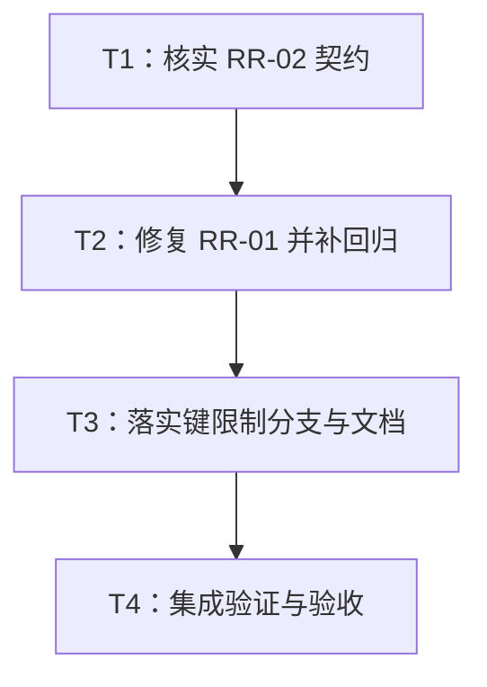

# RR-01 / RR-02 JSON 预算修复实施计划

> **面向智能体执行者：** 使用 executing-plans 技能按任务顺序实施，使用复选框记录进度。本计划不要求为这项局部修复创建新的 Paseo workspace，也不要求启动子智能体。

**目标：** 修复 RR-01 的 JSON Serde 结构漏计，并核实 RR-02 的键长度作用域。

**架构：** 复用现有 `serialize_structured` 和 scope，不合并账本。JSON Option 自身拥有节点；disabled JSON 文本为字符串叶子计节点；JSON 树保持现有准入责任。RR-02 先核查，再按证据选择文档化或修复分支。

**技术栈：** Rust 1.94、Serde、serde_json、serde_test、现有 Cargo feature 矩阵。

**仓库：** `/data/working/qubit/rust-common/rs-redact`。

**配套设计：** [设计文档](design-20261031T165330893Z-3efbb497.md)。文档按用户指定路径保存在 doc，不使用临时文档工作区。

## 全局约束与范围

- 纳入 RR-01（已确认 / P2）与 RR-02（待验证 / P2）；没有明确搁置或拒绝的条目。
- 始终中文回复；仅修改直接相关内容，不顺手重构、格式化或清理无关文件。
- CI 仅验证当前 crate 自身，不加入或保留 downstream all-features 测试。
- 在当前 Paseo workspace 工作，不创建或打开新的 Paseo workspace。
- 保护既有 Cargo.lock、fuzz/Cargo.lock 变更与两份历史文档的删除状态；不擅自删除、移动或批量处理无关文件。
- 本计划不是 git add/commit/push 授权；后续实施命令若明确授权，则按该授权及按需 Git 规则执行，不把当前方案阶段边界沿用为实施禁令。
- 改生产 Rust、rustdoc、测试前，按用户全局规则分别读取 rust-coding.mdc、rust-comment.mdc、rust-test.mdc；已确认缺陷按 bug-fix.mdc 执行。只有触发对应操作时才读取相应规则，不遍历规则目录。
- 本轮不修改公共 API、依赖、feature 图，不重写整个序列化框架。实施时先复核当前基线与环境，本文中的前轮探针结果不是实施验证。

## 调度图

采用同一工作树中的顺序执行：T1 冻结 RR-02 契约证据；T2、T3 的潜在写入集均包含 JSON 预算适配文件，不能并发修改。T4 独占最终全量验证，全部 Cargo 重型命令属于同一 target 资源组。

| 任务 | 前置任务 | 最小解锁产物 | 写入集合（相对仓库） | 本地验证 | 集成验证归属 | 审查时机 |
| --- | --- | --- | --- | --- | --- | --- |
| T1 | 无 | RR-02 基线证据与分支裁决 | 本设计 RR-02 核查记录（实施时追加） | 证据路径、历史版本及探针入口互相核对 | T4 | 立即审查 |
| T2 | T1 | RR-01 可审查实现及红绿回归记录 | src/domain/internal/redact_json_serialize.rs；tests/option_projection_admission_tests.rs | Option/disabled JSON 聚焦回归 | T4 | 立即审查 |
| T3 | T2 | RR-02 分支落实及双语契约 | tests/format_key_limits_tests.rs；两份 redaction_limits rustdoc；双语 user_guide/design；分支 B 才改设计列明的 JSON 准入文件 | 键作用域及受影响 JSON 回归 | T4 | 立即审查 |
| T4 | T3 | 门禁记录与最终相关 diff | 仅修复前序任务引入的直接问题；最终验收记录 | diff、文档一致性检查 | T4 独占 CI、Clippy、rustdoc 等全量检查 | 立即审查 |

## 任务拓扑依赖图



## T1：核查 RR-02，固定实现方向

**输入：** 当前源码与配套设计第 2、5 节。**输出：** A/B 分支及证据，不新增公共接口。

- [ ] 记录 `git status --short`、`git diff --stat`、当前 HEAD，确认既有改动；检查目标文件在实施前是否被其他任务修改。
- [ ] 读取 `RedactionLimits`、builder、JSON 文本 visitor、借用 Value visitor、Serde JSON 路径和现有键限制测试。
- [ ] 用只读 `git log -S 'max_key_bytes' -- src doc tests`、`git show <查得提交>:<具体路径>` 追溯通用限制与 JSON 专属限制。记录实际查得的提交与原文，不推断不存在的契约。
- [ ] 编写最小行为探针或聚焦用例，分别设置 `(max_key_bytes,max_json_key_bytes)=(1,32),(32,1),(1,1)`，输入 `{"longkey":"visible"}`；控制组使用 `longkey=visible` 的 HTTP form。记录现状，再覆盖 UTF-8、转义键和目标入口。不得将仅确认现状的测试称为失败回归。
- [ ] 按设计第 5 节裁决：缺少明确共享覆盖证据时选择 A；有明确共享覆盖契约且无后续撤销时选择 B。将结论和证据追加到设计，不将“用户接受核查”写成“用户确认缺陷”。

**完成条件：** 分支明确；若真实冲突阻塞 RR-02，记为未解决并继续不依赖它的 RR-01，不虚报全部结案。

## T2：RR-01 的失败回归和最小修复

**文件：** 修改 `src/domain/internal/redact_json_serialize.rs`、`tests/option_projection_admission_tests.rs`。优先复用已有测试入口；不新建与已有目标重复的测试套件。

**接口：** 继续使用现有 `RedactJsonSerialize::serialize_redacted_json<S>(serializer, policy) -> Result<S::Ok,S::Error>`，不修改签名或 trait 能力要求。

- [ ] 在现有测试目标内，按 `cfg(feature="json")` 添加派生测试类型和预算辅助函数。最小失败案例形状如下，实际并入文件时复用现有 imports/helper：

```rust
#[derive(qubit_redact::Redact)]
#[redact(serde)]
struct JsonOptional {
    #[redact(json)]
    value: Option<Option<serde_json::Value>>,
}

#[derive(qubit_redact::Redact)]
#[redact(serde)]
struct JsonText {
    #[redact(json)]
    value: String,
}

// root=1，外层 Option=2，内层 None=3。
// 仅限制 nodes=1 或仅限制 depth=1 时，不得输出原来的 null。
// 两项额度都充足时，原表示必须保留。
let source = JsonOptional { value: Some(None) };
let rejected = redactor.to_json(&source).expect("safe replacement fits");
assert_eq!(serde_json::from_str::<serde_json::Value>(&rejected).unwrap()["value"],
           serde_json::json!("<redacted>"));
```

- [ ] 对 None 测试节点/深度边界 1 与 2；对 Some(None) 测试边界 1、2、3。节点与深度分别受限，另一项保持充分。覆盖启用和 disabled。对 disabled JsonText 分别测试 1 拒绝、2 原值保留。补足三种入口：view、to_json、派生源对象 Serialize。
- [ ] 源对象 Serialize 使用带 Drop 恢复的 application-default guard；同一测试可执行文件里所有修改默认策略的测试共享同一锁，不能添加互不协调的局部锁。必要时将相关断言合并到单个测试。不能依赖测试失败后再手动恢复。
- [ ] 运行失败回归：`cargo test --locked -p qubit-redact --no-default-features --features derive,json --test option_projection_admission_tests`。确认失败来自预期的 null/原字符串继续输出，而非编译错误、feature 跳过或空测试集。
- [ ] 导入并复用 `serialize_structured`；Option 的现有 match 改为：

```rust
super::redact_serialize_scope::serialize_structured(serializer, policy, |serializer| {
    match self {
        Some(value) => serializer.serialize_some(&RedactedJsonSerializeRef::new(value, policy)),
        None => serializer.serialize_none(),
    }
})
```

- [ ] 在 `serialize_json_text` 中将 disabled 分支移到通用 `admit_input(text.len())` 之前，分支内部先做结构准入再做一次输入和载荷计量；删除原先裸的 disabled return：

```rust
if policy.is_disabled() {
    return super::redact_serialize_scope::serialize_structured(serializer, policy, |serializer| {
        if !admit_input(text.len()) {
            return super::redact_serialize_scope::serialize_payload(serializer, masked());
        }
        super::redact_serialize_scope::serialize_payload(serializer, text)
    });
}
```

- [ ] 保持启用 JSON 文本、Value、引用和 Box 原有准入责任；不在 `RedactedJsonSerializeRef::serialize` 统一加节点。检查 opaque replacement 仍由现有载荷检查处理，拒绝不继续访问子值。
- [ ] 重跑上述目标确认回归变绿。补 `serde_test` Some/None token 断言、受拒子回调计数与失败后的独立执行恢复；验证输入/载荷/输出小额度仍按各自合同失败或安全替代。足够预算的 String 与 Value 不重复计数。
- [ ] 运行不启用 json 的控制配置：`cargo test --locked -p qubit-redact --no-default-features --features derive,serde --test option_projection_admission_tests`；确认既有普通 Option 行为保持。

**完成条件：** 失败用例在修改前失败、修改后通过；预算充分时成功输出及事件不变。记录测试数量、退出码及实际断言。

## T3：落实 RR-02 的证据分支与双语说明

**输入：** T1 裁决及 T2 实现。**输出：** 入口限制合同、对应测试与文档；无新增公共 API。

- [ ] 在 `tests/format_key_limits_tests.rs` 增加最小对照矩阵，输入包括 `longkey`、`é`、JSON 转义键。JSON 入口至少覆盖文本、Value、HTTP JSON body；派生 JSON 字段的 scope 路径由相关 serde 用例覆盖。
- [ ] **A 分支：** 断言 JSON 仅受 JSON 专属键限制，form/URI 受通用键限制；交换两项额度以证明作用域。测试核心应等价于：

```rust
// limits.max_key_bytes(1).max_json_key_bytes(32)
assert!(redactor.redact_json(r#"{"longkey":"visible"}"#).complete_text().is_ok());
// limits.max_key_bytes(32).max_json_key_bytes(1)
assert!(redactor.redact_json(r#"{"longkey":"visible"}"#).complete_text().is_err());
```

- [ ] **B 分支，仅 T1 证据触发：** 先将上述第一个断言改为拒绝，并证明现状失败；然后在文本 `JsonStructureAdmission`/visitor 和 Value `JsonUsageVisitor` 的既有准入阶段加入通用键检查，检查点位于键解码之后、规范化/分类之前。Serde JSON 的字段路径在既有结构检查阶段执行同样的键合同；复用 `check_key_bytes` 或当前结构 ledger，不修改通用 BudgetSerializer 的所有普通 map 行为。
- [ ] B 分支的文本、Value、HTTP body、派生字段均验证“通用或 JSON 专属任一上限拒绝即安全拒绝”；保留各入口已有错误/替代类型，不新增 reason 枚举。HTTP JSON 行为随共享 JSON 准入生效，不另建平行实现。disabled 原文本不新增解析。每个实际新增生产修改必须能关联一个失败回归。
- [ ] 运行 `cargo test --locked -p qubit-redact --no-default-features --features derive,http,uri --test format_key_limits_tests`，以及 B 分支实际触及路径的已有聚焦目标；重跑 T2 目标防止 JSON scope 回归。
- [ ] 更新 `src/policy/redaction_limits.rs`、`src/policy/redaction_limits_builder.rs` 的英文 rustdoc，明确两项键限制作用域；在双语 `doc/user_guide*` 与 `doc/design*` 的相关预算章节同步合同。A 分支给出同时设置两项限制的短示例；B 分支说明两项均生效及收紧行为。
- [ ] 双语手册记录 RR-01 新增的 Option/disabled 叶子计量边界及受限调用方迁移方法。README 仅在确有必要时添加短链接提示，不改其余结构或措辞。

**完成条件：** RR-02 的状态与证据一致；A 是契约澄清，B 才是缺陷修复。测试结果不能代替意图证据。

## T4：最终集成验证与交付

**接口：** 聚合 T1—T3 的实际 diff、分支裁决和验证记录，不引入新能力。

- [ ] 审查最终修改集合，确认没有带入既有锁文件和历史文档删除，也没有修改下游或新增 downstream all-features CI。
- [ ] 按仓库规则运行 `./.infra/bin/align-ci.sh`；立即检查 `git diff --check` 和最终 diff。若工具触及无关文件，保留用户原改动，只修正本轮引入内容，不用批量恢复命令清理工作树。
- [ ] 运行 `./.infra/bin/style-check.sh`、`cargo check --locked --workspace --all-targets`、`cargo clippy --locked --workspace --all-targets --all-features -- -D clippy::double_must_use`。逐项保留退出码；该 crate features 可组合，但执行前仍需核对当前 manifest。
- [ ] 运行一次 `./.infra/bin/ci-check.sh`，检查其现有矩阵对默认、derive/serde、derive/json、HTTP 及全 features 的覆盖，不加入下游矩阵。若 CI 已执行同一配置的 doc/test，不重复全量运行；仅补缺失配置和本轮相关检查。
- [ ] 对新增或修改的带注解文档示例，按项目现有 `scripts/check_doc_examples.py` 机制验证；CI hook 已运行且覆盖时直接引用其记录。不为本轮小修复额外重复 coverage 或长时间 fuzz；已有 CI 要求仍必须完成。
- [ ] 对比双语预算段落、rustdoc 与实际测试结论，检查文档相对链接，确认默认预算、依赖版本、源值不变和 wire type 没有被意外修改。
- [ ] 输出 RR-01、RR-02 各自最终状态、文件位置、分支依据、测试命令与结果、兼容性影响和任何未验证范围。遇到真实阻断如实记录，不把部分通过写成全量通过。Git 提交、推送、版本发布按后续实施命令授权另行处理。

## 需求到任务的自检映射

| 设计要求 | 任务 |
| --- | --- |
| 全部采纳范围与无排除项；保护当前工作树 | T1、T4 |
| RR-02 保持疑点身份、先核查再决定 | T1、T3 |
| Option 层节点/深度、disabled 字符串叶子、无重复准入 | T2 |
| source/view/to_json、None/Some、节点与深度独立边界、错误恢复 | T2 |
| 两项键限制、UTF-8/转义键、跨 JSON 入口合同 | T3 |
| 最小修改、双语同步、兼容性与迁移 | T2、T3 |
| 当前 crate 门禁、无 downstream all-features、最终真实状态 | T4 |

本阶段交付的是设计与计划；上述复选框属于下一实施阶段，尚未执行。
